{/* Generated from docs/agent-forge.md in LinuxDevil/agent-sdk by scripts/sync-sdk-docs.mjs. Do not edit here. */}

Agent Forge (`apps/agent-forge`، واسمه الثاني الـ Studio) هو الـ dashboard
المرافق لهذه الـ SDK: تطبيق واحد فيه navigation على اليسار تبني منه الـ
agents وتشغّلها، وتجرّب الـ prompts، وتقرأ اللي سوّته الـ agents حقتك من
الـ observe daemon. تبني فيه graph الـ agent على canvas (لوحة الرسم)،
تشغّله، تحاوره، وتكتب pre/post hooks تشتغل داخل sandbox (بيئة معزولة)
(وكل هذا يقرأ ويكتب نفس ملف `AgentSpec` YAML اللي يستخدمه `lousho dev`
و`lousho build`)، وتجرّب الـ prompts في playground، وتقرأ من
[الـ observe daemon](/ar/observability#الـ-observe-daemon) الـ traces والـ
threads ومراقبة الـ fleet ودرجات الـ evals والـ datasets وطوابير التعليق
(annotation queues) وسجل الـ prompts والـ context hub. تشغّله بأمر واحد:
`lousho studio`، ويأتي ضمن حزمة npm للـ SDK نفسها.

هذه الصفحة تغطي: التثبيت، الـ quickstart مع `lousho studio`،
[الـ navigation والشاشات](#الـ-navigation)، جولة أول agent، كتابة hooks، الـ
time travel (إعادة run من خطوة سابقة)، الـ endpoint حق الـ playground،
وكيف تشتغل إعدادات الـ secrets والـ deploy.

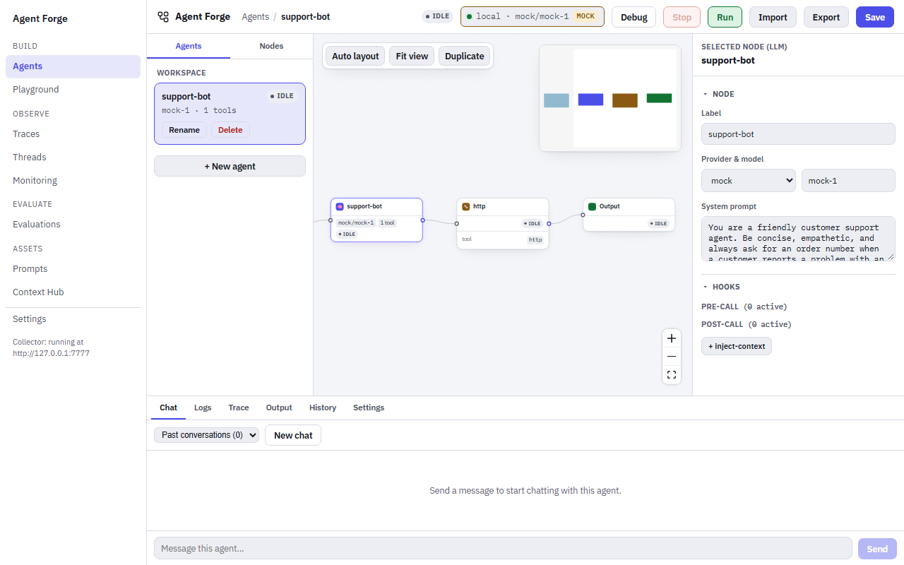

## التثبيت

Agent Forge يأتي داخل `lousho` نفسه — ما في حزمة منفصلة
تثبّتها:

```bash
npm install lousho
```

هذا كل شي. `lousho studio` (تحت) يشغّل نسخة جاهزة من التطبيق، فما تحتاج
كود `apps/agent-forge` المصدري ولا الـ devDependencies الخاصة به (Vite،
`tsx`، غيرها) حتى تستخدمه.

إذا كنت تشتغل داخل الـ monorepo الخاص بالـ SDK نفسها (تساهم في Agent Forge
ذاته)، انظر [وضع التطوير](#وضع-التطوير) تحت.

## البدء السريع

```bash
npx lousho studio
```

الأمر يشغّل سيرفر محلي واحد ويطبع الرابط (الافتراضي
`http://127.0.0.1:4750/?token=<random>`). افتح هذا الرابط بالضبط في المتصفح.
يفتح على شاشة Agents (`#/agents`): الـ navigation على اليسار، وشريط
أدوات البناء (اسم الـ agent وحالة الـ run، وشارة الـ model، وبعدها Debug
وStop وRun وImport وExport وSave)، وشريط الـ agents (الـ agents
المحفوظين + لوحة nodes وhooks)، والـ canvas، والـ Inspector على اليمين،
وdrawer سفلي فيه tabs Chat وLogs وTrace وOutput وHistory وSettings. الـ
agent ينفتح بدون أي شي محدد والـ graph كامل معروض في الشاشة؛ الـ
Inspector يبقى مطوي لين تحدد node، أو تضغط زر **Inspector** في الزاوية
العلوية اليمنى للـ canvas (اسمه للـ accessibility هو "Show inspector")،
وهذا الاختيار ينحفظ. باقي الشاشات على بعد ضغطة في الـ navigation؛ انظر
[Navigation](#الـ-navigation).

لما يكون العرض أقل من 860px، الـ navigation يصير drawer تفتحه من زر
**Navigation** (القائمة) فوق؛ اختيار شاشة أو الضغط على الخلفية المعتمة
أو Esc يسكّره. في شاشة Agents، شريط الـ agents والـ Inspector يصيرون
لوحات منزلقة تفتحها من الشريط العلوي؛ Run (أو Stop) وSave يبقون في
الشريط، وDebug وImport وExport وشارة الـ model ينتقلون لقائمة **More
actions** (`⋯`) فيه.

flags مفيدة:

```bash
npx lousho studio --port 5000       # pick a different port
npx lousho studio --host 0.0.0.0    # bind to all interfaces
npx lousho studio --prod            # force production mode (see below)
npx lousho studio --dev             # force dev mode (monorepo only)
```

### رمز الوصول

الـ studio يقدر يخزّن مفاتيح الـ providers، ويبدأ runs، وينفّذ كود الـ
hooks، فالـ API الخاص به مقفول على tab المتصفح اللي فتحته من الرابط
المطبوع:

- كل تشغيل يولّد token عشوائي ويطبعه في الرابط (`?token=...`). الصفحة
  تحتفظ به لهذا الـ tab (يبقى بعد الـ reload) وترسله مع كل استدعاء API
  (header `x-lousho-studio-token`) ومع الـ WebSocket (query `?token=`).
  أي طلب بدونه يرجع `401`. لو فتحت `http://127.0.0.1:4750` بدون token
  في tab جديد، الصفحة تنفتح لكن استدعاءات الـ API فيها تفشل لين تستخدم
  الرابط المطبوع.
- السيرفر ما يرسل أي CORS headers، ويرفض (`403`) أي طلب `Origin` حقه
  مو origin الـ studio نفسه، أو `Host` حقه مو اسم loopback
  (`localhost`، `127.0.0.1`، `[::1]`) ولا الـ `--host` اللي ربطت عليه. مع
  `--host 0.0.0.0` أي `Host` ينقبل، والـ token يصير الحماية الوحيدة.
- `GET /health` والـ client الـ static ما يحتاجون token.

من `curl`، مرّر الـ token: `curl -H "x-lousho-studio-token: $TOKEN" localhost:4750/agents`.

`lousho studio` يمرّر هذي القيم للعمليات اللي يشغّلها عبر متغيرات بيئة؛
ما تحتاج تضبطها بنفسك إلا لما تشغّل سيرفر الـ studio بدون الـ CLI:

| المتغير | يقرؤه | المعنى |
| --- | --- | --- |
| `LOUSHO_STUDIO_TOKEN` | API server الخاص بالـ studio | رمز الوصول. إذا ما انضبط، السيرفر يولّد واحد عشوائي لكل تشغيل. |
| `LOUSHO_STUDIO_ALLOWED_ORIGINS` | API server الخاص بالـ studio | origins إضافية مفصولة بفواصل تنقبل غير origin الـ studio نفسه (وضع dev يضبطها على origin الـ Vite dev server). |
| `LOUSHO_STUDIO_API_URL` | الـ Vite dev server (وضع dev) | وين يمرّر استدعاءات الـ API (الافتراضي `http://127.0.0.1:4750`). |

### وين تعيش الـ agents

`lousho studio` يحفظ ملفات specs الـ agents وحالة الـ runs تحت `.lousho/`
في المجلد اللي شغّلته منه: ملفات YAML للـ agents تحت `.lousho/agents/`،
وبجانبها الـ checkpoints (نقاط الحفظ) والـ approvals. نفس ترتيب `.lousho/`
اللي يستخدمه `lousho dev` و`lousho build`. ملفات الـ YAML هذي مستندات
[Agent spec v2](/ar/agent-spec)، والصفحة هذيك تشرحها حقل حقل.

شريط الـ agents في شاشة Agents يعرض بالضبط الـ agents الموجودة في `.lousho/agents/` هذا:
أي ملف YAML تضيفه هناك يظهر، وأي agent تنشئه في الـ studio ينكتب هناك
فورًا (الـ autosave و**Save** الاثنين يكتبون الملف)، فتقدر تحاوره على
طول. مشروع ثاني، مفتوح في `lousho studio` خاص به، يعرض الـ agents حقته
فقط. المتصفح ما يحتفظ بشي إلا مسودة لتعديل ما قدر يوصل للسيرفر (تنرسل
في التحميل الجاي)، محفوظة لكل مجلد workspace على حدة. أي ملف في
`.lousho/agents/` ما عاد ينقرأ صح يتم تخطيه مع تحذير في سجل السيرفر.

### وضع production ووضع dev

`lousho studio` عنده وضعين ويختار المناسب منهم تلقائيًا:

- **Production** (الافتراضي بعد ما يُبنى Agent Forge): سيرفر Express واحد
  يقدّم الـ REST/WebSocket API *و* الـ client الجاهز (تطبيق React) كملفات
  static على port واحد. هذا اللي يشتغل لما تثبّت الحزمة المنشورة بـ
  `npm install` — ما في Vite dev server منفصل ولا TypeScript loader.
- **Dev** (يرجع له إذا البناء ما صار بعد، يعني داخل نسخة source من هذا الـ
  monorepo): الـ API server يشتغل مباشرة من كود TypeScript عن طريق `tsx`،
  ومعه Vite dev server حقيقي (مع hot-module reload) يمرّر له طلبات الـ
  API. عمليتين، portين داخليًا، أمر واحد.

`--prod` و`--dev` يفرضون واحد من الوضعين. شغّل بدون أي flag منهم
و`lousho studio` يكتشف الوضع بنفسه حسب وجود
`apps/agent-forge/dist-server`.

## الـ Navigation

الـ navigation على اليسار يعرض كل الشاشات، مقسّمة لمجموعات:

| المجموعة | العنصر | الشاشة |
| --- | --- | --- |
| Build | **Agents** | الـ builder: الـ canvas والـ Inspector والـ drawer السفلي. شريط أدوات البناء (Run وStop وDebug وImport وExport وSave وشارة الـ model) يظهر هنا فقط. |
| Build | **Playground** | جرّب رسائل على model بدون ما تعدّل agent. |
| Observe | **Traces** | كل run موجود عند الـ observe daemon، مفلتر ومرتب؛ الضغط على صف يفتح الـ trace. |
| Observe | **Threads** | الـ sessions (المحادثات): صف لكل session، وturn لكل run. |
| Observe | **Monitoring** | صحة الـ fleet ورسومات بيانية على فترة زمنية. |
| Evaluate | **Evaluations** | tabs لـ Scores وDatasets وEvaluators وAnnotation queues. |
| Assets | **Prompts** | سجل الـ prompts: الإصدارات، الـ labels، الفروقات. |
| Assets | **Context Hub** | قيم key-value مشتركة تنشرها الـ agents للـ daemon. |
| | **Settings** | المظهر، مفاتيح الـ providers، profiles الإعدادات، الـ deploy، الـ collector، والاختصارات. |

برّا شاشة Agents، في header للصفحة يسمّي الشاشة ويحط pill حالة الـ run
الحي في آخر سطر العنوان، بعد أي chips تضيفها الشاشة (مثلًا labels الـ
prompt). تحت Settings، بطاقة صغيرة تعرض حالة الـ collector (انظر
[الـ collector](#الـ-collector-الـ-observe-daemon)). الزر اللي جنب اسم
**Agent Forge** أعلى الـ nav (**Collapse navigation**) يصغّره لشريط
أيقونات؛ مرّر الماوس على أيقونة حتى تشوف اسمها. الاختيار ينحفظ بعد الـ
reload. لما يكون العرض أقل من 860px، الـ nav دائمًا يكون الـ drawer
الكامل.

### الـ Routes والروابط المباشرة

كل شاشة لها hash route، وفلاتر الشاشة تعيش في الـ query string حق الـ
URL، فالـ reload أو الـ bookmark أو رابط تلصقه يفتح نفس الشاشة بنفس
الفلاتر. القيم الافتراضية ما تنكتب أبدًا (`#/traces` لوحده هو القائمة
الافتراضية لآخر 24 ساعة). تعديلات الفلتر والترتيب والصفحة تستبدل الإدخال
الحالي في الـ history، وفتح صف يضيف إدخال جديد، فزر Back في المتصفح يرجّعك
من trace للقائمة بدل ما يمشي على تعديلات الفلاتر وحدة وحدة. الـ hash
الفارغ أو غير المعروف يروح لـ `#/agents` (والـ `?token=` يبقى).

| الـ Route | الشاشة | مفاتيح الـ query |
| --- | --- | --- |
| `#/agents`, `#/agents/<agent id>` | Agents، مع فتح هذا الـ agent | |
| `#/playground` | Playground | `trace` + `fromObs`، أو `prompt` (انظر [Playground](#playground)) |
| `#/traces` | قائمة الـ Traces | `agent`، `status`، `model`، `project`، `q`، `prompt` (`<name>` أو `<name>@<version>`)، `from` + `to` (ms epoch، نصف مفتوح)، `sort` (`duration`، `tokens`، `cost`) + `order` (`asc`، `desc`)، `offset` |
| `#/traces/<trace id>` | trace واحد | `obs` (الخطوة المحددة) |
| `#/threads` | قائمة الـ Threads | `agent`، `status`، `from` + `to`، `offset` |
| `#/threads/<session id>` | thread واحد | |
| `#/monitoring` | Monitoring | `window` (`1h`، `24h`، `7d`، `30d`؛ الافتراضي `24h`)، `agent` |
| `#/evals/scores` | Scores | `eval` (قائمة مفصولة بفواصل)، `agent`، `source` (`eval`، `judge`، `human`، `online`)، `range` (الافتراضي `30d`)، `open` (الـ eval الموسّع) |
| `#/evals/datasets`, `#/evals/datasets/<name>` | Datasets، dataset واحد | `offset` |
| `#/evals/evaluators`, `#/evals/evaluators/<rule id>` | Evaluators، شاشة تعديل rule واحدة | `kind` (`code`، `judge`)، `enabled` (`true`، `false`)، `offset`؛ وعلى rule: `trace` (يعبّي Test on trace مسبقًا) |
| `#/evals/queues`, `#/evals/queues/<queue id>` | Annotation queues، مراجعة queue واحد | `offset` (للقائمة) |
| `#/prompts` | سجل الـ prompts | |
| `#/prompts/<name>`, `#/prompts/<name>@<version or label>` | prompt واحد (أحدث إصدار افتراضيًا) | `diff=<a>,<b>` |
| `#/hub`, `#/hub/<namespace>` | Context Hub | `agent` (الـ agent في "Viewing as")، `scope` (`private`، `fleet`) |
| `#/settings` | Settings | |

الفترة الزمنية اللي تختارها من preset غير الافتراضي تنكتب كحدود `from`/`to`
مطلقة، فالـ reload يعرض نفس الصفوف بالضبط. القائمة الكاملة للـ routes في
`apps/agent-forge/src/screens/routeTable.ts`.

### لوحة المفاتيح

| المفاتيح | وظيفتها |
| --- | --- |
| `Ctrl+K` / `Cmd+K` | تفتح (أو تسكّر) الـ command palette، من أي مكان، حتى وأنت تكتب. |
| `?` | تعرض اختصارات لوحة المفاتيح (مو وأنت تكتب في حقل). |
| `j` / `k` | الصف التالي / السابق في جدول عليه الـ focus. |
| `Enter` | تفتح الصف المحدد. |
| `Esc` | تسكّر الـ palette، أو قائمة الاختصارات، أو dialog في الـ header، أو drawer الـ nav في العرض الضيق. |

الـ command palette يعرض **Go to** لكل شاشة في الـ nav، و**Open agent**
لكل agent محفوظ، و**Toggle theme** (فاتح/داكن، ينحفظ في المتصفح)؛ اكتب
حتى تفلتر. الصق trace id (8 أو أكثر من أرقام hex وشرطات) وأول عنصر يصير
**Open trace** له. الأسهم تتنقل، وEnter ينفّذ.

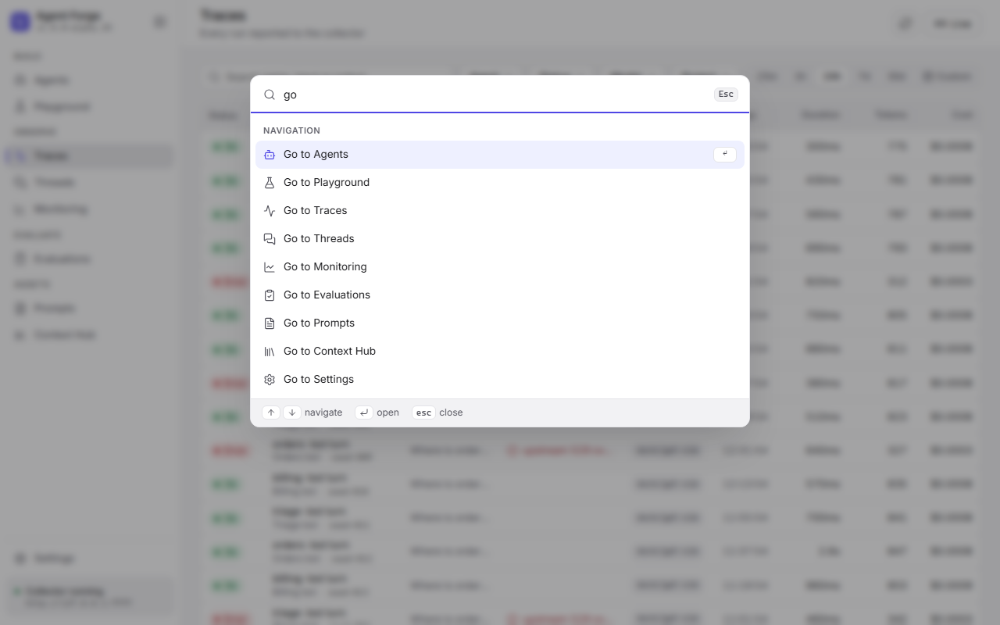

في مراجعة annotation queue، Enter يرسل الدرجات و`S` يتخطى العنصر (انظر
[Annotation queues](#annotation-queues)).

### كلمات الحالة

كل حالة في الـ Studio هي نفس الـ pill:

- الـ Runs: `ok`، `error`، `running`، `interrupted` (عملية الـ agent ماتت
  في نص الـ run؛ انظر [الـ observe daemon](/ar/observability#الـ-observe-daemon)).
- الـ Agents: `healthy`، `stale` (فاتته heartbeats)، `down`، `stopped`.
- الـ Threads: `active`، `ended` (خامل، انظر
  [الـ sessions الخاملة](/ar/observability#الجلسات-الخاملة))، `interrupted`.
- الـ Scores: `pass`، `fail`.
- runs الـ builder: `idle`، `running`، `done`، `stopped`، `error`،
  `awaiting approval`.

### الـ collector (الـ observe daemon)

كل شي تحت Observe وEvaluate وAssets يقرأ من الـ observe daemon
(`lousho observe start`) عبر الـ proxy `/observe` في سيرفر الـ Studio. الـ
proxy يقرأ `LOUSHO_OBSERVE_URL` فقط (الافتراضي `http://127.0.0.1:7777`)؛
`LOUSHO_OBSERVE` ما يغيّر المكان اللي تقرأ منه الشاشات (هو بس يحدد وين
تبلّغ runs الـ builder، انظر [الجولة](#جولة-أول-agent)). لما يكون
`LOUSHO_OBSERVE_TOKEN` مضبوط، الـ proxy يرسله للـ daemon كـ bearer token
مع كل قراءة وكتابة (مثل ما يسوّي تبليغ الـ runs والـ judge evaluators)،
فالشاشات تشتغل كمان مع daemon مشغّل بـ `--require-token`. بدونه، هذا
الـ daemon يرد بـ `401` على كل قراءة `/api/` والشاشات تعرض هذا الخطأ بدل
البيانات (`/health` يبقى يرد، فبطاقة الـ collector تقول إنه شغال). الـ
credentials حقت المتصفح نفسه (token الـ Studio، الـ cookies،
`Authorization`) ما تنمرّر أبدًا. الـ proxy يمرّر القراءات فقط مع
الكتابات اللي تسوّيها الشاشات (درجات الـ feedback، إصدارات prompts جديدة
من الـ Playground، نقل labels الـ prompts، تعديلات عناصر الـ hub، كتابات
الـ datasets والأمثلة، كتابات الـ annotation queues، كتابات rules الـ
evaluators)؛ أي كتابة ثانية، وأولها الـ ingest، تنرفض بـ `405`. ودائمًا
يستدعي الـ daemon على `LOUSHO_OBSERVE_URL`، مهما كان الـ host المذكور في
سطر الطلب.

بطاقة الـ collector أسفل الـ nav تقول إذا الـ daemon يرد:
**Checking collector…** لين أول فحص، وبعدها **Collector running** أو
**Collector unreachable**، مع URL الـ daemon تحتها. الفحص يستمر بشكل
دوري. طالما الـ daemon واقف، كل شاشة تعتمد عليه تعرض الأمر اللي يشغّله
بدل خطأ، وتحتفظ بالـ URL حقها، وترجّع البيانات بنفسها أول ما الـ daemon
يرد. شاشة Agents وruns الـ Playground ما تحتاج الـ daemon.

## الشاشات

### Agents

الـ builder: انظر [جولة أول agent](#جولة-أول-agent).
`#/agents/<id>` يفتح هذا الـ agent؛ إذا طلعت من الشاشة (أو بدّلت agent)
وعندك تعديلات ما انحفظت، يسألك أول. الـ runs اللي تبدأها هنا تبلّغ الـ
observe daemon، ورابط **Open trace** في pill حالة الـ Run يفتح الـ run في
شاشة Trace.

### Playground

`#/playground` (Build > Playground) يجرّب رسائل على model بدون ما تعدّل
agent:

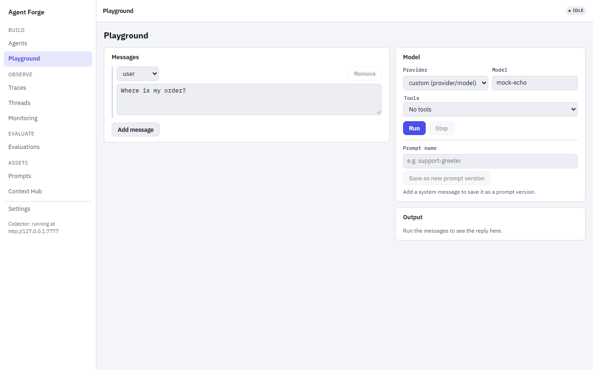

- **Messages**: بطاقات رسائل system وuser وassistant. كل placeholder
  `{name}` في أي رسالة ياخذ حقل إدخال في **Variables** ضمن بطاقة
  الإعدادات على اليسار، بترتيب أول ظهور للأسماء.
- **Model**: provider (اللي لهم مفتاح تحت Settings > Provider keys، زائد
  `ollama` و`mock`؛ و`mock` لما ما في شي مضبوط) واسم model، ينرسلون كـ
  `provider/model`.
- **Tools**: اختر agent محفوظ حتى تستعير الـ tools حقته، وبعدها شغّل أو
  طفّ كل واحدة.
- **Run** (أو Ctrl/Cmd+Enter في الرسائل) يبث الرد أول بأول؛ **Stop**
  يلغيه. الـ tool calls تظهر كبطاقات تنفتح على الـ arguments حقتها. لما
  الـ run يخلص، المخرجات تعرض الـ tokens الداخلة والخارجة والـ latency
  والتكلفة (لما يكون سعر الـ model معروف)، و**Open trace** يروح للـ trace
  حقه.
- **Save prompt** (في header الصفحة) يفتح بطاقة فيها **Save as new
  prompt version** يدفع رسالة الـ system (والـ variables حقتها) لسجل الـ
  prompts، تحت اسم الـ prompt المحمّل أو اسم تكتبه. يكون معطّل طالما ما
  في رسالة system.

في رابطين يعبّونه مسبقًا. **Open in Playground** على model call
(generation) في trace يفتح `#/playground?trace=<traceId>&fromObs=<obsId>`،
ويحمّل رسائل هذا الـ generation والـ model حقه. `#/playground?prompt=<name>[@<label or
version>]` (زر **Open in Playground** في شاشة Prompts) يحمّل prompt من
السجل (الأحدث افتراضيًا) كرسالة system ويسجّله على trace الـ run.
الاثنين يقرؤون من الـ observe daemon: لما يكون واقف، الـ Playground يقول
هذا ويبقي المحرر فاضي، والـ runs تشتغل عادي. الـ runs تمر عبر
[الـ endpoint حق تشغيل الـ playground](#الـ-endpoint-حق-تشغيل-الـ-playground) وتبلّغ
كـ agent `playground`.

### Traces

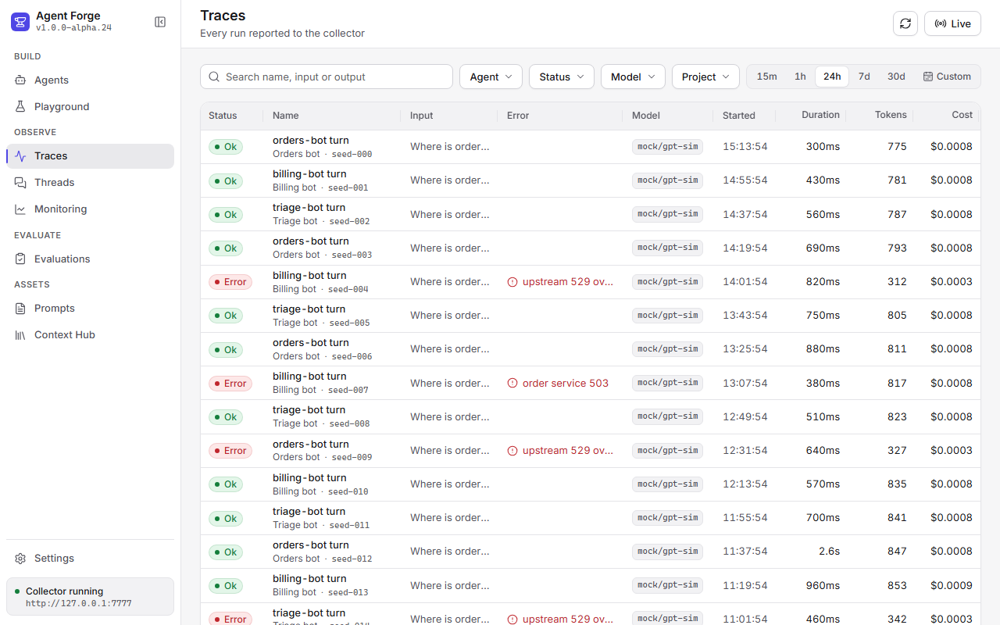

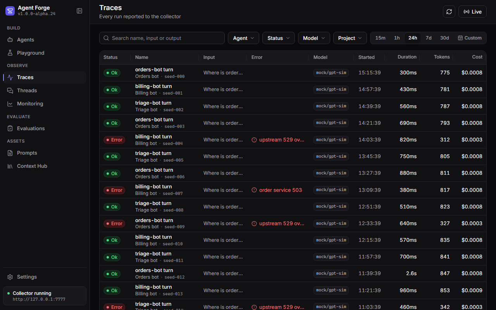

نفس القائمة بالثيم الداكن (Settings > Appearance، أو **Toggle theme** في
الـ command palette).

`#/traces` يعرض runs الـ daemon، الأحدث أول: الحالة، الاسم، الـ agent،
معاينة المدخلات والمخرجات، رسالة الخطأ، الـ model، البداية، المدة، الـ
tokens والتكلفة (النوافذ الضيقة تخفي الأعمدة الأقل أهمية). فلتر بمربع
البحث (الاسم أو المدخلات أو المخرجات)، والـ facets **Agent** و**Status**
و**Model** و**Project**، وفترة زمنية (15m أو 1h أو 24h أو 7d أو 30d أو
Custom؛ الافتراضي آخر 24 ساعة). اضغط **Duration** أو **Tokens** أو
**Cost** حتى ترتب عليه. 50 صف في الصفحة. أيقونة التحديث في header الصفحة
(**Refresh**) تجيب القائمة من جديد الحين، و**Live** (toggle) يحدّثها كل 5
ثواني لين تطفّيه أو يوقف الـ daemon. فلتر `prompt` (يضبطه رابط "Runs
using this version" في شاشة Prompts) يظهر كـ chip تقدر تشيله.

### Trace

`#/traces/<trace id>` هو run واحد. الـ header فيه اسمه، حالته، الـ agent
(رابط لـ traces الـ agent)، الـ model، البداية، المدة، الـ tokens،
التكلفة والـ session (رابط للـ thread حقه)، زائد **Copy link** و**Add to
dataset** و**Add to queue**، و**Open in Playground** لما يكون في الـ run
model call. **All traces** في header الصفحة يرجّعك للقائمة.

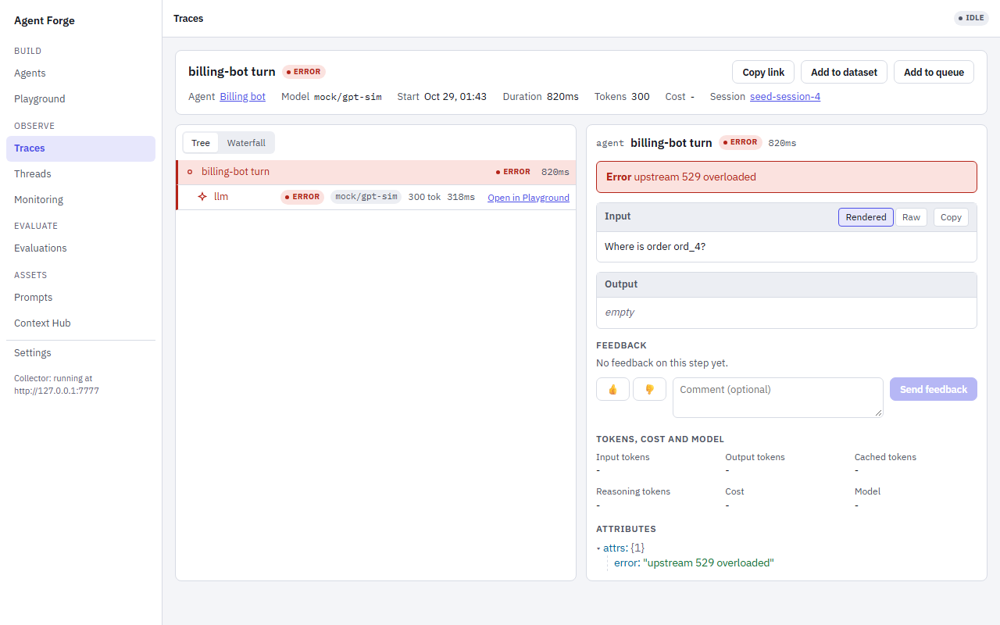

تحته الـ trace viewer اللي يستخدمه كمان tab Trace في الـ builder ومراجعة
الـ queue: الخطوات كـ **Tree** أو **Waterfall** (switch بخيارين فوق
الخطوات)، وinspector للخطوة المحددة (الخطوة الفاشلة تنحدد افتراضيًا،
وإلا الجذر). الخطوة المحددة هي `?obs=` في الـ URL. الـ inspector يعرض،
بالترتيب:

1. **Error**: رسالة الفشل، لما تكون الخطوة فشلت.
2. **Input** و**Output**: الرسائل تنعرض كفقاعات chat والـ tool calls
   كـ chips؛ بدّل بين **Rendered** و**Raw** و**JSON** (للمحتوى اللي هو
   JSON)، وانسخ أي واحد من الاثنين.
3. **Feedback**: درجات الخطوة، وإعجاب / عدم إعجاب مع تعليق اختياري،
   ينحفظ كدرجة `feedback` (`1` أو `0`، المصدر `human`). على خطوة الجذر
   يقيّم الـ trace كامل.
4. **الـ tokens والتكلفة والـ model**.
5. **Attributes**: الـ attributes الخام للخطوة كشجرة JSON.

صفوف الـ model calls فيها **Open in Playground**.

**Add to dataset** ينسخ مدخلات الـ run (ومخرجاته، كقيمة متوقعة) إلى
dataset تختاره، أو dataset جديد تسمّيه. **Add to queue** يحط الـ trace في
annotation queue للمراجعة.

### Threads

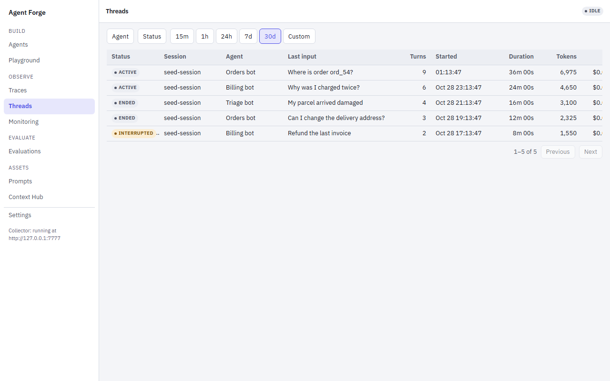

`#/threads` يعرض الـ sessions: الحالة، الـ session id، الـ agent، آخر
مدخل، الـ turns، البداية، المدة، الـ tokens والتكلفة، مفلترة بالـ agent
والحالة والفترة الزمنية (الافتراضي 30 يوم). الـ session يظهر أول ما
تحمل runs الـ agent `sessionId`. `#/threads/<session id>` يعرض المحادثة:
كل turn (run) من الأقدم للأحدث، مع مدخلاته ومخرجاته (أو الخطأ) ورابط
**Open trace**.

### Monitoring

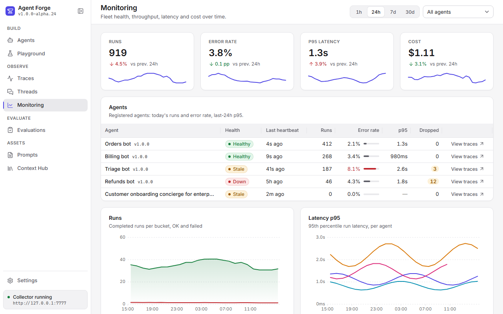

`#/monitoring` هي شاشة "هل الـ fleet حقي شغال" وتحدّث نفسها كل 15 ثانية.
جدول الـ fleet يعرض كل agent بلّغ: الحالة، آخر heartbeat، runs اليوم،
نسبة الأخطاء، الـ p95 latency على 24 ساعة، عدد الأحداث اللي أسقطها الـ
reporter، ورابط للـ traces حقته. تحته، اختر window (1h، 24h، 7d، 30d)
وagent، واقرأ خمس رسومات: **Runs** و**Latency p95** و**Error rate** (لكل
agent)، و**Cost** و**Tokens**. اضغط على bucket في رسمة حتى تفتح Traces
مفلترة على وقت هذا الـ bucket (والـ agent).

### Evaluations

**Evaluations** في الـ nav يفتح `#/evals/scores`. sub-navigation أعلى كل
شاشة Evaluations (**Scores** و**Datasets** و**Evaluators** و**Annotation
queues**) يتنقل بينها.

#### Scores

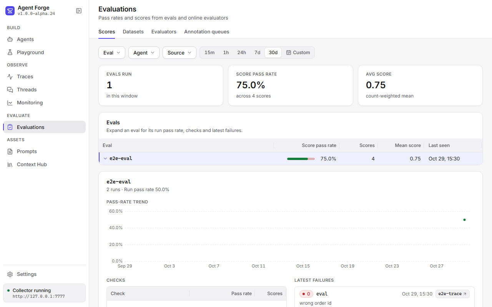

صف لكل eval: نسبة نجاح الدرجات، عدد الدرجات، متوسط الدرجة وآخر ظهور، على
كل درجات الـ eval (صف الـ eval لكل run زائد صفوف الـ checks حقته). فلتر
بالـ eval والـ agent والمصدر (`eval`، `judge`، `human`، `online`)
والفترة الزمنية (الافتراضي 30 يوم). اضغط على eval حتى توسّعه: عدد الـ
runs ونسبة نجاح الـ runs، اتجاه نسبة النجاح، نسبة نجاح كل check (الأسوأ
أول) وآخر حالات الفشل، وكل وحدة فيها رابط للـ trace حقها (والخطوة).
الدرجة تُحسب نجاح لما تكون قيمتها 1 بالضبط. درجات `eval` و`judge` (الـ
assertions حقت الـ eval والـ checks `llmJudge` / `t.judge()`، اللي تكتب
تعليق بس لما تفشل) تنجح كمان لما ما يكون عندها تعليق فشل. درجات `human`
و`online` يحكم عليها بالقيمة وحدها، فالـ 0 (عدم إعجاب، أو rule رجّعت 0)
أو 0.9 أو قيمة فاضية تُعتبر فشل. الجدول والتفاصيل الموسّعة يستخدمون نفس
القاعدة. من وين تجي درجات الـ eval: [Evals](/ar/evals#lousho-eval).

#### Datasets

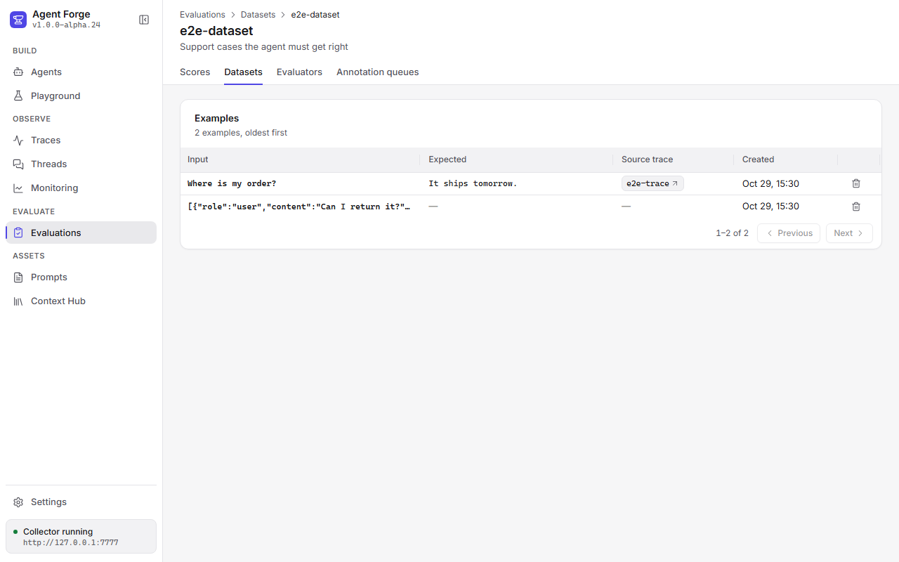

`#/evals/datasets` يعرض الـ datasets مع عدد الأمثلة في كل واحد، وفيه
فورم **New dataset** (اسم ووصف اختياري). افتح واحد حتى تشوف أمثلته
(المدخل، القيمة المتوقعة، الـ trace المصدر)؛ افتح مثال حتى تشوفه كامل،
أو **Delete** حتى تحذفه (يسألك أول). الأمثلة تجي من **Add to dataset** في
trace، أو يدويًا عبر [الـ datasets API](/ar/observability#مجموعات-البيانات-datasets). الـ
eval يشتغل على dataset بـ `defineEval({ dataset: 'name' })` (انظر
[Datasets](/ar/evals#من-الـ-daemon)).

#### Evaluators

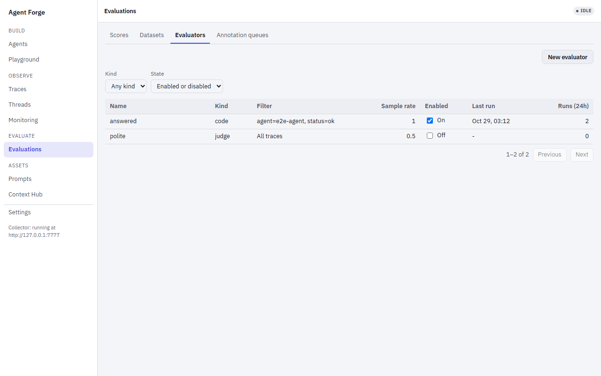

`#/evals/evaluators` يدير [rules الـ evaluators
الأونلاين](/ar/observability#قواعد-التقييم-الحي-online-evaluator-rules): rules تعطي درجات
للـ traces الجديدة أول ما تخلص. درجاتها تحمل اسم الـ rule وتظهر في Scores
بالمصدر `online`.

القائمة تعرض لكل rule اسمها، نوعها (`code` أو `judge`)، الفلتر (أو "All
traces")، الـ sample rate، switch **Enabled** (يشغّل الـ rule أو يطفّيها
فورًا)، و**Last run** و**Runs (24h)**، محسوبة من أحدث 1000 درجة أونلاين
(`+` بعد العدد يعني إن القراءة كانت ممتلية، فالعدد حد أدنى). فلتر بـ
**Kind** و**State** (`?kind=`، `?enabled=`)، 50 rule في الصفحة.

**New evaluator** يفتح الفورم؛ افتح rule (`#/evals/evaluators/<rule
id>`) حتى تعدّلها في نفس الفورم، وهناك **Save changes** يرسل بس الحقول
اللي غيّرتها، و**Delete** يشيل الـ rule بعد تأكيد (درجاتها السابقة
تبقى). الفورم فيه اسم، sample rate (0-1)، مربع enabled، الفلتر (الـ
agent، الحالة `ok` أو `error`، الاسم يحتوي على)، والنوع:

- rule من نوع **code** هي دالة `(trace) => number | { value, comment }`،
  معبّأة مسبقًا بمثال شغال. الـ observe daemon يشغّلها في الـ isolate
  sandbox حقه، فالـ code rules تشتغل سواء الـ Studio مفتوح أو لا (انظر
  [الـ evaluators الأونلاين](/ar/observability#التقييم-الحي-online-evaluators)).
- rule من نوع **judge** هي provider وmodel وrubric. الـ daemon ما عنده
  مفاتيح providers، فالـ Studio هو اللي يشغّل الـ judges، بمفتاح محفوظ في
  Settings أو بمتغير البيئة حق الـ provider في المكان اللي يشتغل فيه الـ
  Studio (المفتاح المحفوظ يغلب)؛ قائمة الـ providers تعرض اللي عندهم واحد
  من الاثنين، زائد `ollama` و`mock`. بدون أي مفتاح، خيار الـ judge يكون
  معطّل، مع رابط لـ Settings. الـ judges تشتغل بس طالما `lousho studio`
  شغال؛ لين ذاك الوقت الـ jobs حقتها تنتظر في الـ daemon (انظر
  [Judge rules](/ar/observability#قواعد-الحَكَم-عبر-agent-forge)). اضبط
  `LOUSHO_STUDIO_JUDGE=0` على سيرفر الـ Studio حتى تطفّي حلقة الـ judge
  حقه.

**Test on trace** في صفحة الـ rule يجرّبها تجربة جافة على trace id واحد
(`?trace=` يعبّيه مسبقًا) ويعرض القيمة والتعليق؛ ما تنكتب أي درجة. الـ
Studio يشغّل rule الـ judge بنفسه ويمرّر rule الـ code للـ daemon. الـ
trace غير المعروف يعرض "Trace not found".

#### Annotation queues

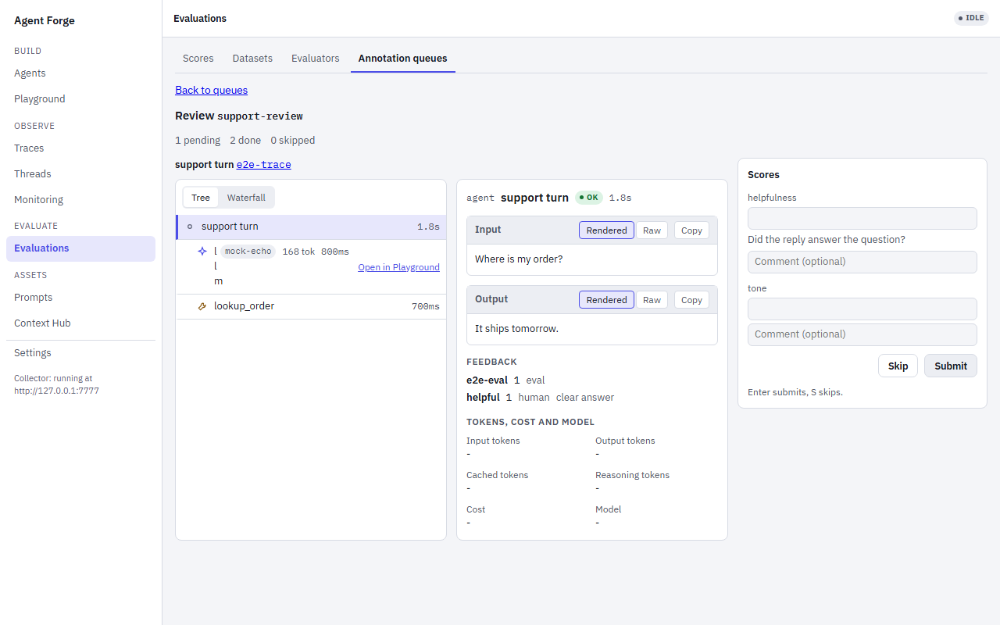

`#/evals/queues` يعرض الـ queues (pending، done، skipped) وفيه فورم **New
annotation queue**: اسم وrubric، صف لكل درجة (الاسم، وصف اختياري، min وmax
اختياريين). أضف traces من **Add to queue** في trace (أو مجموعة مرة وحدة
عبر [الـ queue API](/ar/observability#طوابير-المراجعة-annotation-queues)). افتح queue حتى
تراجعه: trace العنصر الـ pending التالي في الـ trace viewer، وجنبه حقل
رقم واحد (ضمن حدود الـ rubric) وتعليق اختياري لكل عنصر في الـ rubric.
**Submit** (Enter) يحفظ الدرجات المعبّأة كدرجات human على الـ trace وينتقل
للعنصر التالي؛ **Skip** (`S`) يتخطاه. الحقل الفاضي ما ينحسب كدرجة. لما
ما يكون في شي pending، الشاشة تقول إن الـ queue فاضي.

### Prompts

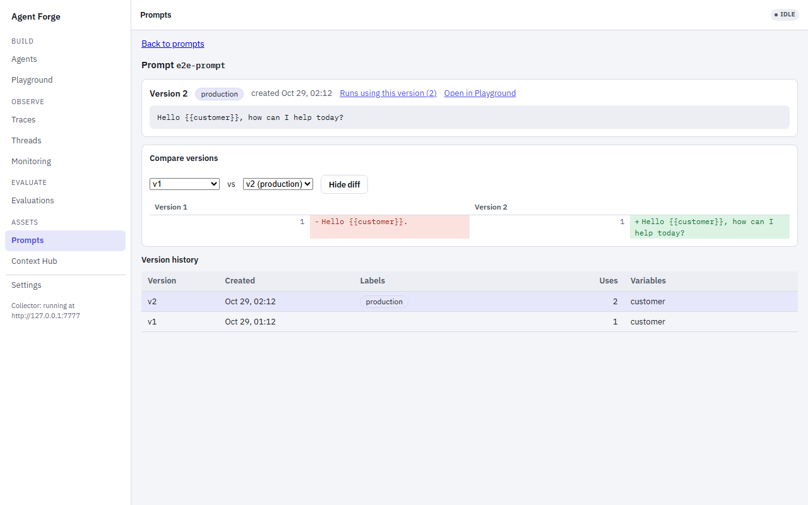

`#/prompts` يعرض السجل، صف لكل prompt: أحدث إصدار، الـ labels، عدد
الإصدارات، الـ runs اللي استخدمته، ومتى تحدّث؛ مربع البحث يفلتر القائمة
بالاسم. افتح واحد (`#/prompts/<name>`، أو `@<version>` /
`@<label>` حتى تحدد إصدار):

- الـ header: اسم الـ prompt مع labels الإصدار المحدد، و**Runs using
  this version** (Traces مفلترة بـ `prompt=<name>@<version>`) و**Open in
  Playground**.
- نص الإصدار المحدد، مع أرقام الأسطر، و**Move `<label>`
  here** لكل label من labels الـ prompt يشير لمكان ثاني: الـ label يشير
  لإصدار واحد بالضبط، فهذا ينقله (نفس `lousho prompt label`، انظر
  [CLI](/ar/cli#lousho-prompt)).
- **Compare versions**: اختر إصدارين لـ diff (`?diff=a,b`)، يُعرض
  **Unified** أو **Side by side**.
- تاريخ الإصدارات، timeline جنب النص؛ اختر إصدار حتى تحدده (`j`/`k`
  يتنقلون بين الإصدارات).

### Context Hub

`#/hub` يعرض namespaces الـ [context hub](/ar/observability#الـ-observe-daemon).
الـ daemon يقدّم عناصر الـ hub بس نيابة عن agent، فاختر أنت مين في
**Viewing as** (الافتراضي أول agent بالاسم)، واختياريًا scope (`private`
أو `fleet`). افتح namespace حتى تشوف عناصره كبطاقات (المفتاح، الـ scope،
معاينة القيمة، اللي كتبه، آخر تحديث والـ TTL)؛ افتح بطاقة حتى تشوف القيمة
كاملة (الـ JSON كشجرة) جنب القائمة. عنصر الـ fleet فيه زر **Edit** يعيد
نشره (وهذا يعيد بداية الـ TTL حقه).

### Settings

`#/settings` عمود واحد من البطاقات: **Appearance** (الثيم Light أو Dark
أو System، وكثافة الجداول Compact أو Comfortable، والاثنين ينحفظون في
هذا المتصفح؛ لين تختار كثافة، كل جدول يبقى على الافتراضي حق شاشته)،
و**Provider keys**، و**Settings profile**، و**Deploy target**، و**Collector**
(هل الـ observe daemon يرد، عنوانه، و`lousho observe start` لما يكون
واقف) و**Keyboard shortcuts** (نفس قائمة الـ `?`). tab **Settings** في
drawer الـ builder يعرض بس بطاقات مفاتيح الـ providers والـ profile والـ
deploy؛ انظر [الإعدادات وsecrets وربط الـ deploy](#الإعدادات-وsecrets-وربط-الـ-deploy).

## جولة أول agent

1. **أنشئ agent.** في tab **Agents** بشريط الـ agents، اضغط **New agent**، سمّه،
   واختر قالب بداية. أسرع طريق للتجربة بدون مفاتيح API هو **Blank
   graph** — node `llm` واحد يستخدم الـ `mock` provider المدمج. Agent
   Forge ينشئ الـ agent بهذا الاسم (`.lousho/agents/<name>.yaml`، مع
   `name: <name>` في الـ spec) ويفتحه على الـ canvas. بطاقة الـ agent
   المفتوح فيها **Rename** و**Delete**. الـ Rename ينقل الـ spec للاسم
   الجديد؛ المحادثات والـ traces والـ checkpoints السابقة تبقى تحت الاسم
   القديم.
2. **شوف الـ graph.** الـ agent الفارغ هو node `llm` واحد. اسحب nodes
   إضافية من tab **Nodes** في الشريط (**Trigger**، **LLM step**، **Tool
   call**، **Approval gate**، **Response / output**)، أو اضغط على عنصر في
   Nodes (أو اضغط Enter عليه) حتى تضيفه في وسط الـ canvas، ووصّلهم ببعض
   بالسحب بين الـ handles. كل بطاقة node تعرض اسمه، وchip الـ
   `provider/model` وعدد الـ tools لو كان node من نوع LLM، وحالة الـ node في
   الـ run الحالي (`idle` لين يوصله run). اضغط على node لتعدّل إعداداته
   (prompt، provider/model، tools، breakpoints) في الـ Inspector على
   اليمين؛ أقسامه **Node** و**Debug** و**Hooks** تنطوي، وكل قسم يبقى على
   الحالة اللي تركته عليها. الـ agent اللي الـ canvas حقه ما فيه nodes
   يعرض القوالب على الـ canvas: اختيار واحد يعبّي الـ canvas (بدون حفظ لين
   يصير autosave، مثل أي تعديل) ويحتفظ باسم الـ agent.
3. **شغّله.** اضغط **Run** في الشريط العلوي. مع الـ `mock` provider ما
   في شي يحتاج إعداد — يرجّع مخرجات جاهزة وثابتة، وهذا بالضبط المطلوب
   حتى تجرب باقي الواجهة بدون مفتاح API لـ LLM حقيقي. الـ status pill في
   الشريط العلوي يتتبع الـ run (`running` → `done`، أو `stopped` بعد ما
   تضغط **Stop**، أو `error`، أو `awaiting approval`)، وأول ما يكون trace
   id حق الـ run معروف، يظهر جنبه رابط **Open trace** يفتح الـ run على
   `#/traces/<traceId>` (في العرض الضيق يكون في قائمة **More**). runs الـ
   builder تبلّغ الـ observe daemon كـ agent `<agent id>`، بنفس طريقة الـ
   Playground: لما يكون `LOUSHO_OBSERVE` مضبوط، الـ reporter حقه هو اللي
   ينستخدم (ما في شي يتبلّغ مرتين)، والـ daemon الواقف بس يسقط الأحداث
   وأبدًا ما يفشّل الـ run، ومحتوى الرسائل ينرسل بس لـ daemon على
   loopback (أبدًا لملفات الـ trace ولا لـ tab Trace الحي). الـ Run يرسل
   prompt ثابت، وtab الـ Chat يعرضه كفقاعة **Run input** بدل ما يعرضه كرسالة
   منك. إذا سيرفر الـ studio وقف، يظهر banner يقول إن الاتصال انقطع،
   والـ studio يرجع يتصل لما السيرفر يرجع.
4. **تابعه في الـ debug console.** افتح tab **Logs** في الـ drawer
   السفلي لسجل حي تقدر تفلتره لأحداث الـ run
   (trigger/llm/tool/sandbox/checkpoint/approval)، أو **Trace** لخطوات الـ
   run في نفس الـ trace viewer اللي تستخدمه شاشة Traces (شجرة أو
   waterfall (مخطط شلالي)، مع inspector للخطوة المحددة). فعّل **Debug** من الشريط العلوي —
   أو ضع breakpoint على node في الـ Inspector — حتى توقّف الـ run عند
   حدود الـ LLM والـ tool وتتقدم فيه خطوة خطوة بأزرار **Step** و
   **Continue** في شريط الـ debug. وسّع "Live message array" هناك لتفحص
   قائمة الرسائل الجارية. tab **Output** يعرض `ExecutionResult` كامل
   (messages، tool calls، usage، steps) كشجرة JSON قابلة للطي أول ما الـ
   run يخلص أو يتوقف. اسحب الحافة العلوية للـ drawer (أو حط عليها الـ
   focus واستخدم الأسهم) حتى تغيّر حجمه؛ والارتفاع ينحفظ.

   **سجل الـ traces.** كل run ينحفظ كملف trace، فtab **Trace** يحتفظ بـ
   runs الـ agent حتى بعد reload للصفحة أو إعادة تشغيل السيرفر. قائمة
   على اليسار تعرض الـ runs السابقة للـ agent، الأحدث أول (وقت البداية،
   المدة، model calls، tokens داخلة وخارجة، التكلفة، الحالة)، وفوقها
   عنصر **Live** طالما في run شغال. اختر واحد وتشوف خطواته في نفس الـ
   viewer: نوع كل خطوة (model call أو tool call أو span)، والـ model،
   والـ tokens، والمدة، والخطوات الفاشلة بلون الخطأ مع رسالة الفشل في الـ
   inspector، والخطوات اللي لسا شغالة تتحدث مباشرة. تحديد خطوة يظلّل الـ
   node حقها على الـ canvas. القائمة تتحدث لما run يخلص. الملفات هي
   نفسها اللي يقرأها `lousho traces`، في
   `.lousho/agents/<agent id>/traces/<day>/<trace id>.jsonl` تحت المجلد
   اللي بدأت `lousho studio` منه (انظر
   [التتبّعات المحلية](/ar/observability#local-traces)):
   `npx lousho traces --dir .lousho/agents/<agent id>/traces` يعرض نفس
   الـ runs في الـ terminal، وحذف مجلد الـ agent يحذف الـ traces الخاصة
   به. الـ tab يعرض محتوى الـ spans: أسماء الـ models والـ tools، أعداد
   الـ tokens، التكلفة، المدد، ورسائل الخطأ؛ وفي أقسام Input وOutput
   وAttributes بالـ inspector تطلع الـ attributes اللي تحمل محتوى الـ
   prompt والـ tools. السيرفر
   يقرأ الـ traces من هذا المجلد فقط (id فيه فاصل مسار = 400)، وأبدًا ما
   يرسل مسار الملف للمتصفح. خلّ `.lousho/` خارج الـ version control.
5. **حاوره.** tab **Chat** هو transport محادثة منفصل (`POST
   /agents/:id/message`، والرد يوصل streaming عبر نفس الـ WebSocket اللي
   يخدم كل شي ثاني) — أرسل له رسالة ويرد لك في الـ thread، مستقل عن زر
   "Run" للـ graph فوق. كل agent يحتفظ بتاريخ محادثاته (`+ New chat`
   يبدأ session (جلسة) جديدة، والقديمة تبقى قابلة للتصفح).
6. **وافق على tool call متوقف.** أضف node **Tool call**، افتحه في الـ
   Inspector، واختر tool — بعض الـ tools (أو policy الـ agent نفسه)
   تقدر تطلب approval (موافقة بشرية) قبل التشغيل. لما run أو chat يوصل
   لواحدة، تظهر بطاقة approval مدمجة — في الشريط العلوي إذا كان run من
   الـ graph، أو كفقاعة رسالة في الـ chat — تعرض اسم الـ tool والـ
   arguments الخاصة به. اضغط **Approve** حتى يكمل أو **Reject** حتى
   تلغي هذا الـ call، والـ run يرجع يكمل تلقائيًا في الحالتين.

## Hooks

الـ hooks دوال صغيرة تشتغل داخل sandbox، وتشتغل مباشرة قبل أو بعد tool
call أو `generate` لـ LLM — نفس الآلية اللي يعرضها قلب الـ SDK باسم
`HookRegistry`/`AgentHook` (انظر [نظرة عامة على الـ
API](/ar/api-overview))، بس مكتوبة بشكل مرئي ومرتبطة بـ node محدد على الـ
canvas.

لإرفاق hook:

1. اختر node `llm` أو `tool` على الـ canvas — الـ hooks تنطبق على هذين
   النوعين فقط، لأنهما النقطتان الوحيدتان اللي `AgentExecutor` يستدعي
   فيهما الخارج فعليًا.
2. افتح قسم **Hooks** في الـ Inspector. اسحب **Pre-hook** أو
   **Post-hook** من tab **Nodes** في الشريط وأفلته على الـ node — أو أفلته
   مباشرة في قسم Hooks — أو اضغط على العنصر في اللوحة والـ node محدد،
   لإرفاق hook جديد. يعطيك اختيار من قوالب بداية
   (`redact-pii`، `rate-limit`، `audit-log`، `inject-context`) تبدأ منها
   وتعدلها.
3. اضغط على chip الـ hook لتحدده، وعدّل كوده في محرر CodeMirror. الكود
   هو **جسم** دالة async، والسيرفر يستدعيها بـ `hook(ctx)` داخل
   subprocess معزولة (`server/hookSandbox.ts`) — أبدًا في المتصفح ولا في
   عملية الـ API server نفسها:
   - لـ hook خاص بـ tool call: `ctx` هو `{ toolName, args, result?,
     error? }`. الـ pre-hook يقدر يعدّل `ctx.args`، والـ post-hook يقدر
     يفحص أو يعدّل `ctx.result` و`ctx.error`. رجّع `ctx`.
   - لـ hook خاص بـ `generate` لـ LLM: `ctx` هو `{ messages, model }`.
     عدّل `ctx.messages` أو أضف عليها، ورجّع `ctx`.
   - **رمي exception يلغي الخطوة** — hook الـ rate-limit مثلًا يرمي
     exception حتى يمنع الـ tool call نهائيًا بدل ما يخليه ينفذ.
4. بدّل الـ switch على chip الـ hook لتفعيله أو تعطيله بدون إزالته، أو
   اضغط **x** لإزالته كليًا. الـ hooks المفعّلة فقط هي اللي تدخل في الـ
   run.

مثال: pre-hook يخفي الـ PII على node من نوع tool — وهذا قالب البداية
`redact-pii`:

```js
const PII = /[a-z0-9._%+-]+@[a-z0-9.-]+\.[a-z]{2,}/gi;
for (const key of Object.keys(ctx.args || {})) {
  if (typeof ctx.args[key] === 'string') {
    ctx.args[key] = ctx.args[key].replace(PII, '[REDACTED]');
  }
}
return ctx;
```

لما تحفظ الـ agent، هذي الـ hooks تنخزن كـ `spec.policy.hooks` في ملف الـ
YAML الخاص به، والسيرفر يعمل compile للـ hooks المفعّلة إلى
`HookRegistry` حقيقي للـ run (`server/compileHooks.ts`)، ويوجّهها عبر نفس
الـ `SandboxAdapter` اللي تستخدمه الـ tool داخل sandbox.

## Time travel

Agent Forge يحتفظ بكل الـ checkpoints لكل run، لا الأخيرة فقط. الـ file
store الخاص به (`server/checkpointStore.ts`) يحتفظ بنفس السجل المحدود اللي
يحتفظ به `LocalStorageCheckpointStore` في الـ SDK — أحدث 50 حفظة لكل run،
تحت `.lousho/agents/<id>/checkpoint-history/` (انظر [سجل الـ
checkpoints](/ar/durable-execution#checkpoint-history)). من هذا
السجل تقدر تعمل fork (تفريع) لـ run عند أي خطوة، تغيّر اللي صار فيها،
وتعيد تشغيله بجانب الأصل —
[`AgentExecutor.fork()`](/ar/durable-execution#fork-و-replay)
و`compareTrajectories()` هما اللي يقومون بالشغل.

### tab History

1. شغّل الـ agent — زر **Run** في الشريط العلوي أو رسالة في الـ Chat.
2. افتح tab **History** في الـ drawer السفلي. يسرد خطوات الـ run: رقم
   الخطوة، الحالة، سبب إنهاء الـ model، الـ tool calls اللي صارت، وعدد
   الـ tokens وتكلفة استدعاء الـ model في الخطوة لما تكون معروفة.
3. اضغط **Edit and replay from here** على خطوة. اختر **Append a user
   message** واكتب رسالة، أو اختر واحد من الـ tool calls في الخطوة وعدّل
   نتيجته — الحقل يكون معبّأ مسبقًا بالنتيجة المسجلة، وإذا النص يصلح
   JSON يُرسل كـ JSON.
4. اضغط **Fork and replay**. النظام يعمل fork للـ run عند تلك الخطوة مع
   تعديلك ويبدأه كـ run جديد باسم `<id>.fork-<n>`.
5. الـ fork ينفتح بجانب الأصل في عرض trajectory جنبًا إلى جنب: كل model
   turn من الـ runين — النص، الـ tool calls ونتائجها — وأول turn
   يختلفان فيه مظلّل بوسم **diverged**، وتحته عناصر الـ drift (ترتيب الـ
   tools، الـ arguments، عدد الخطوات، سبب الإنهاء). العرض يتحدث لما الـ
   fork يخلص.

### Routes

معرّف الـ run هو الـ checkpoint session id الخاص به: id الـ agent للـ
runs الخاصة بالـ agent نفسه، و`<id>.fork-<n>` لـ fork من الـ run `<id>`.
سيرفر التحكم بالـ runtime عنده ثلاث routes لها (tab History يستخدمها)،
ورouteين ثانيين للـ traces المحفوظة للـ agent (tab Trace يستخدمهم):

| Route | وظيفته |
| --- | --- |
| `GET /runs/:id/history` | `{ runId, steps }`: مدخل لكل خطوة من آخر تنفيذ للـ run — أحدث checkpoint محفوظة عند تلك الخطوة — مرتبة من الأقدم للأحدث، مع `status` و`savedAt` و`finishReason` و`toolCalls` (`{ id, name, args, result? }`)، و`tokens`/`costUsd` لاستدعاء الـ model في الخطوة إذا معروفة. يرجع 404 إذا الـ run ما عنده checkpoints. |
| `POST /runs/:id/fork` | الـ body هو `{ fromStep, patch? }`، و`patch` يكون `{ toolResult?: { toolCallId, result }, appendInput?, businessState? }`. يعمل fork للـ run عند `fromStep`، ثم يبدأ الـ fork عبر الـ run registry بنفس spec الـ run الأصلي. يرجع 202 `{ runId, fromStep, status }`. الـ fork يبث على `WS /agents/<runId>/stream` ويبلّغ عن حالته على `GET /agents/<runId>/status` مثل أي run ثاني. يرجع 400 إذا الـ body غلط أو `toolCallId` غير معروف، و404 لـ run غير معروف أو خطوة بدون checkpoint. |
| `GET /agents/:id/traces?limit=N` | `{ traces }`: الـ runs المحفوظة للـ agent من `.lousho/agents/<id>/traces`، الأحدث أول. `limit` افتراضيًا 20 وأقصى قيمة 200. كل عنصر فيه `traceId` و`name` و`startTime` و`durationMs` و`status` و`modelCalls` و`toolCalls` و`inputTokens` و`outputTokens` و`costUsd` إذا معروفة. agent بدون runs يرجع قائمة فارغة، وagent غير معروف يرجع 404. |
| `GET /agents/:id/traces/:traceId` | `{ traceId, spans }`: الـ spans لـ run محفوظ واحد مرتبة بوقت البداية، وكل span فيه `id` و`parentId` و`name` و`kind` و`status` و`startTime` و`endTime` و`attributes`. `traceId` يجوز يكون prefix فريد. يرجع 400 لـ id فيه غير حروف وأرقام وشرطات، أو prefix يطابق أكثر من run، و404 لـ agent أو trace غير معروف. |
| `GET /runs/compare?a=&b=` | ناتج `compareTrajectories(a, b)` على أحدث checkpoint لكل من الـ runين: الـ model turns لكل run، و`divergedAt` (أول turn يختلف) وعناصر `drift`. يرجع 404 إذا واحد من الـ runين ما عنده checkpoint. |

التسلسل لـ agent اسمه `weather` شغّلته مرة واحدة:

```bash
# $TOKEN is the ?token= value `lousho studio` printed
curl -H "x-lousho-studio-token: $TOKEN" localhost:4750/runs/weather/history
# {"runId":"weather","steps":[{"step":1,"status":"finished","finishReason":"stop","toolCalls":[],"tokens":...}]}

curl -X POST localhost:4750/runs/weather/fork -H "x-lousho-studio-token: $TOKEN" -H 'content-type: application/json' \
  -d '{"fromStep":1,"patch":{"appendInput":"And in Celsius?"}}'
# {"runId":"weather.fork-1","fromStep":1,"status":{"status":"running",...}}

curl -H "x-lousho-studio-token: $TOKEN" 'localhost:4750/runs/compare?a=weather&b=weather.fork-1'
# {"a":[...],"b":[...],"divergedAt":2,"drift":[{"field":"steps","committed":"1","current":"2"}]}
```

الـ fork هو run مستقل بذاته: checkpoints وحالة وchat الـ run الأصلي تبقى
مثل ما هي.

## الـ endpoint حق تشغيل الـ playground

`POST /playground/run` يشغّل prompt لمرة واحدة على model ويبث الرد كـ
server-sent events. يحمل نفس رمز الوصول اللي يحمله باقي الـ API. الـ body:

```json
{
  "messages": [{ "role": "system", "content": "You are {persona}." }, { "role": "user", "content": "Hi {name}" }],
  "variables": { "persona": "a pirate", "name": "Ada" },
  "model": "openai/gpt-4o-mini",
  "tools": ["current-date"],
  "promptRef": "greeter@prod"
}
```

- `messages` (مطلوب): من 1 إلى 200 `{ role, content }`، و`role` واحد من
  `system` أو `user` أو `assistant`. تنرسل مثل ما هي مكتوبة؛ السيرفر ما
  يضيف أي system prompt من عنده.
- `variables`: قيم نصية. كل `{name}` في محتوى أي رسالة ينستبدل بـ
  `variables.name`؛ الـ placeholder اللي ما له variable يبقى مثل ما هو.
- `model` (مطلوب): `provider/model`، أو provider لوحده (`mock`). مفتاح الـ
  provider يجي من Settings > Provider keys، وبعدها من البيئة، بنفس الطريقة
  اللي تحلّه فيها runs الـ agents.
- `tools`: أسماء tools يحلّها الـ Studio للـ agents (`current-date`،
  `day-name`، `http`، `web-fetch`، `demo-approval`). الـ tool اللي تحتاج
  approval تنهي الـ run بـ `finishReason: "awaiting-approval"`؛ الـ
  playground ما فيه مسار approval.
- `promptRef`: الـ prompt من السجل اللي جت منه الرسائل (`name`،
  `name@label` أو `name@3`). ينسجّل بس على الـ trace؛ السيرفر ما يجيب الـ
  prompt.

الـ body الغلط ياخذ `400 { error }`. غير كذا الرد يكون `200` مع
`content-type: text/event-stream`، وframe واحد `data: <json>` لكل event:

| الـ Event | الحقول |
| --- | --- |
| `delta` | `text`: قطعة من الرد. |
| `tool_call` | `id`، `name`، `args`: الـ model استدعى tool. |
| `done` | `finishReason`، `text` (الرد كامل)، `traceId` (trace الـ run في الـ observe daemon)، `usage` لما يكون معروف. آخر event في run خلص. |
| `error` | `message`، و`code` لما يكون خطأ من الـ SDK (`LOUSHO_PROVIDER_UNKNOWN` لـ provider غير معروف، `LOUSHO_PROVIDER_MISSING_API_KEY`، ...). آخر event في run فشل أو ما بدأ أصلًا. |

كل stream ينتهي بـ `done` أو `error` واحد بالضبط، حتى الـ run اللي يوقف
بدون نتيجة. `usage` له نفس شكل الـ usage في event `run.done`
(`AgentEventUsage`).

إغلاق الاتصال يلغي الـ run. كل run يبلّغ الـ observe daemon اللي يقرأ منه
الـ Studio (`LOUSHO_OBSERVE_URL`، الافتراضي `http://127.0.0.1:7777`، أو
`LOUSHO_OBSERVE` لما يكون مضبوط) كـ agent `playground`، مع
`lousho.prompt.ref` على الـ root span حق الـ run لما يكون `promptRef`
موجود. `LOUSHO_OBSERVE_TOKEN` ينرسل كـ bearer token، لـ daemon مربوط على
أبعد من loopback. الـ daemon الواقف ما يبطّئ الـ run ولا يفشّله.

## الإعدادات وsecrets وربط الـ deploy

شاشة Settings (`#/settings`، آخر شاشة في الـ nav) وtab **Settings** في
drawer الـ builder يتشاركون ثلاث أجزاء: مفاتيح API للـ providers (OpenAI
وAnthropic) — Agent Forge يخزنها مشفّرة تحت `.lousho/` وما يعرضها ثانية
أبدًا؛ كل مفتاح يعرض **Set** مع آخر حروفه مخفية جزئيًا، أو **From
environment** لما يكون بس `OPENAI_API_KEY` / `ANTHROPIC_API_KEY` مضبوط،
أو **Not set** — وprofiles إعدادات مسمّاة (provider، deploy
adapter، timeout للـ hook، toggle لـ OpenTelemetry، تُحفظ في
`.lousho/settings.json` اللي ما فيه secrets)، وقسم **Deploy** يختار
adapter — `node-server` أو `docker` أو `cloudflare-worker` — ويشغّل
`lousho build` للـ agent المحدد. باقي الـ providers يقرؤون الـ env vars
الخاصة بهم، نفس طريقة `lousho dev` و`lousho build` (انظر
[الإعداد](/ar/configuration))، والـ `mock` provider ما يحتاج credentials.

المفاتيح المخزّنة مشفّرة بـ AES-256-GCM في `.lousho/secrets.json`. مفتاح
التشفير يتولّد أول مرة تحتاجه وينحفظ جنبه في `.lousho/secrets.key`
(الاثنين بصلاحية `0600` على POSIX). هذا يبعد المفاتيح عن أي شي ينسخ النص
المشفّر وحده — backup، أو zip للمشروع، أو YAML لـ agent تشاركه — لكن أي
أحد يقدر يقرأ الملفين باسم مستخدمك يقدر يفك تشفيرهم. هذا مو keychain
النظام. خلّ `.lousho/` خارج الـ version control وخارج الأرشيفات اللي
تشاركها، وفضّل متغيرات البيئة على الأجهزة المشتركة.

الـ agent اللي الـ provider حقه ما عنده مفتاح (لا مفتاح مخزّن ولا متغير
بيئة) ما يشتغل. **Run** و**Chat** يفشلون بـ
`LOUSHO_PROVIDER_MISSING_API_KEY` ورسالة تقول الحل: أضف المفتاح في
Settings، أو اضبط متغير البيئة، أو غيّر provider الـ agent إلى `mock`. الـ
studio أبدًا ما يبدّل للـ mock provider من نفسه. الـ provider pill في
الشريط العلوي يعرض الـ `provider/model` اللي الـ agent يشتغل عليه فعليًا،
والـ agent اللي يستخدم mock عليه شارة **MOCK**.

## وضع التطوير

إذا كنت تشتغل داخل الـ monorepo الخاص بالـ SDK نفسها — تساهم في Agent
Forge ذاته، لا تستخدمه فقط — `lousho studio` يرجع لوضع dev تلقائيًا طالما
`apps/agent-forge/dist-server` ما بُني بعد:

```bash
git clone https://github.com/LinuxDevil/agent-sdk.git
cd agent-sdk
npm install
npx lousho studio --dev   # or just `npx lousho studio` before building
```

هذا يشغّل الـ API server مباشرة من TypeScript (`tsx`)، ومعه Vite dev
server حقيقي مع hot-module reload لـ `apps/agent-forge/src/**`، كعمليتين
تشتغلان جنب بعض. افتح الرابط المطبوع `http://localhost:5173/?token=...`؛
Vite مثبّت على port 5173 والـ API server يقبل هذا الـ origin. وحتى تبني حزمة الـ production اللي يستخدمها الباقي —
وتتحقق من اللي يُشحن فعلًا:

```bash
npm run build:studio   # builds apps/agent-forge/dist (client) and
                        # apps/agent-forge/dist-server (bundled server)
npx lousho studio       # now runs in production mode
```

`npm run build:studio` يشتغل تلقائيًا أيضًا ضمن سكربت `prepublishOnly` في
جذر الـ repo، فـ `npm publish` ما يقدر يشحن studio قديم أو غير مبني
أبدًا.

## E2E smoke test

`apps/agent-forge/e2e/studio.spec.ts` هو اختبار Playwright headless يقود
`lousho studio` الحقيقي المبني — نفس سيرفر الـ production
`dist-server/index.cjs`، لا Vite dev server — عبر متصفح. ينشئ agent من
قالب "Support bot"، يوجّه الـ tool node فيه لـ tool اسمها
`demo-approval` محلية على السيرفر (`needsApproval: true` دائمًا — انظر
تعليق التوثيق في `server/buildAgent.ts` لتعرف سبب وجودها، لأن أي tool
مدمجة في الـ SDK قابلة للتحديد من الـ spec ما تطلب approval)، يرسل له
رسالة chat تفعّل الـ tool-call heuristic في الـ `mock` provider، ينتظر
توقف الـ run عند الـ approval gate، يوافق عليه من بطاقة الـ approval
المدمجة في tab Chat، وثم يتحقق إن الـ run يكتمل. شغّله بالأمر:

```bash
npm run test:e2e:studio   # from the repo root, or apps/agent-forge/
```

هذا يبني Agent Forge أول (`build:studio`)، ثم يشغّل Playwright عليه:
`studio.spec.ts` اللي فوق زائد باقي الـ specs في `apps/agent-forge/e2e/`،
ومنها `revamp.spec.ts` (فحوصات القبول حقت الـ revamp: خطأ run فاشل يبان
خلال تفاعلين، وكل route يصمد بعد الـ reload مع فلاتره) و`a11y.spec.ts`
(فحص axe لكل route في `routeTable.ts`). شاشات الـ daemon تشتغل على
daemon وهمي (`e2e/observeStub.ts` و`e2e/fixtures/seedObserve.ts`)، فما
تحتاج `lousho observe`.

### لقطات شاشة التوثيق

لقطات الشاشة في هذي الصفحة تجي من `apps/agent-forge/e2e/docShots.spec.ts`،
واللي يتخطى نفسه إلا إذا كان `LOUSHO_DOC_SHOTS` مضبوط. بعد `npm run
build:studio`، أعد توليدها من جذر الـ repo بالأمر:

```bash
LOUSHO_DOC_SHOTS=1 npx playwright test -c apps/agent-forge/playwright.config.ts docShots
```

يكتب `docs/images/studio-<screen>.png` (1280x800، الثيم الفاتح) من نفس
الـ daemon الوهمي. الصور مو جزء من حزمة npm. الأمثلة الداكنة
(`studio-{agents,traces,trace,monitoring}-dark.png`) تجي من نفس الأمر مع
الـ scheme الداكن:

```bash
LOUSHO_DOC_SHOTS=1 LOUSHO_DOC_SHOTS_SCHEME=dark npx playwright test -c apps/agent-forge/playwright.config.ts docShots
```

في `docs/images` الـ spec يتخطى لقطات المراجعة `x-` حقته، والتشغيل الداكن
يكتب بس هذي الأربع.

في متغيرين اختياريين يساعدون تراجع إعادة تصميم قبل وبعد:
`LOUSHO_DOC_SHOTS_OUT=<dir>` يكتب الـ PNGs في مجلد ثاني (مسار مطلق، أو
نسبي للمكان اللي تشغّل منه الأمر)، و`LOUSHO_DOC_SHOTS_SCHEME=dark` يصوّر
الثيم الداكن (`light` هو الافتراضي؛ أي قيمة ثانية تفشّل التشغيل). مع مجلد
مخرجات، كل لقطة تنكتب باسمها، ولقطات المراجعة `x-` معها.

```bash
LOUSHO_DOC_SHOTS=1 LOUSHO_DOC_SHOTS_OUT=/tmp/shots-dark LOUSHO_DOC_SHOTS_SCHEME=dark npx playwright test -c apps/agent-forge/playwright.config.ts docShots
```
