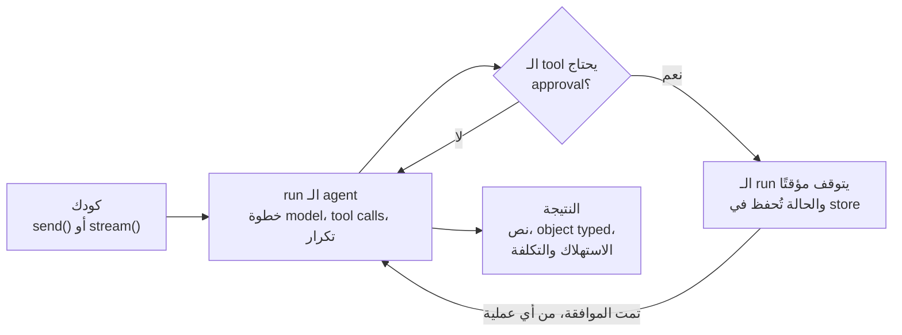

معظم كود الـ agents يبدأ كحلقة تلفّ حول استدعاء model. بعدها يأتي الإنتاج ويطلب أكثر: لازم إنسان يوافق على استرداد المبلغ قبل إرساله. العملية تُعاد تشغيلها والـ run في منتصفه. المحادثة لازم تكمل غدًا من سيرفر آخر. وشخص ما يريد اختبار يفشل لما الـ agent يوقف عن استدعاء الـ tool الصحيح.

`@lousho/build-ai-agent` هي هذه الحلقة وهذه الإجابات مدمجة فيها. مكتبة، لا web framework ولا hosted runtime: حلقة استدعاء tools من نوع typed، مع approvals (موافقات) و sessions (جلسات) و streaming و sub-agents و skills و MCP و CLI. ونفس الـ agent يشتغل في سكربت، أو سيرفر Node، أو حاوية Docker، أو Cloudflare Worker (الـ Worker يدعم [جزءًا](/ar/cloudflare-workers#ما-يعمل-وما-لا-يعمل) فقط من الـ providers والـ tools).



```ts
import { createAgent } from '@lousho/build-ai-agent';

const agent = createAgent({ model: 'openai/gpt-4o-mini', instructions: 'You are a helpful assistant.' });
const { text } = await agent.send('Hello!');
console.log(text);
```

## ما يميّزها

<CardGroup cols={3}>
  <Card title="Durable على أي host" icon="database" href="/ar/durable-execution">
    الـ sessions والـ checkpoints وتوقفات الـ approval محفوظة في stores قابلة للتبديل: الذاكرة، ملفات، ملف SQLite واحد، أو Cloudflare KV. والـ run المتوقف مؤقتًا أو المنقطع يستأنف من طلب آخر أو عملية أخرى.
  </Card>
  <Card title="تُختبر مثل الكود" icon="flask-conical" href="/ar/testing">
    `mockModel` يسكربت ردود الـ model، و`recordReplay` يعيد تشغيل runs حقيقية من cassettes دون اتصال، و`defineEval()` يتحقق من الـ tools التي استُدعيت، وبأي ترتيب، وبأي معاملات.
  </Card>
  <Card title="Node و Workers مع tracing" icon="activity" href="/ar/deployment">
    `lousho build` ينشر spec واحد للـ agent على سيرفر Node أو Docker أو Worker. كل run يصدر spans وفق OpenTelemetry GenAI، وكل نتيجة تذكر استهلاك الـ tokens، والتكلفة بالدولار الأمريكي للـ models ذات السعر المعروف.
  </Card>
</CardGroup>

## المكوّنات

كل مكوّن هو دالة واحدة أو خيار واحد على `createAgent()`. استخدم ما تحتاجه؛ لا مكوّن يتطلب غيره.

| المكوّن | ما تكتبه | ما تحصل عليه |
| ----- | -------------- | ------------ |
| [Tools](/ar/tools) | `defineTool()` مع `input` من zod | معاملات typed مع validation، والاستدعاءات تشتغل بالتوازي |
| [Approvals](/ar/approvals) | `needsApproval`، أو قواعد `permissions` | run يتوقف مؤقتًا بانتظار إنسان، ثم يكمل عبر `agent.approvals.resolve()` |
| [Sessions](/ar/sessions) | `agent.session({ id })` | محادثة متعددة الدورات تُحفظ في الذاكرة أو الملفات أو SQLite |
| [الذاكرة](/ar/memory) | خانات `defineMemory()` | حقائق تدخل الـ prompt عبر الـ sessions، لكل مستخدم أو على مستوى عام |
| [المخرجات المنظمة](/ar/structured-output) | `output: zodSchema` | `result.object` typed مع validation، وخطوة إصلاح واحدة |
| [Streaming](/ar/streaming) | `agent.stream()` | أحداث JSON typed وذات إصدارات، جاهزة لـ SSE |
| [Sub-agents](/ar/sub-agents) | `subagents: { researcher, writer }` | أداة `task` واحدة للـ agent الرئيسي؛ والـ sub-agents تشتغل بالتوازي، محليًا أو عن بُعد |
| [Skills](/ar/skills) | `loadSkills()` | تعليمات ما يحمّلها الـ agent إلا لما تحتاجها المهمة |
| [Providers](/ar/providers) | سلسلة بصيغة `provider/model` | OpenAI أو Anthropic أو OpenRouter أو Ollama أو mock، مع retry و fallback |

## أين يعيش الـ agent

الـ agent هو نفس الكائن في كل مكان. اللي يتغير هو الواجهة اللي تقف أمامه.

<CardGroup cols={2}>
  <Card title="في تطبيق ويب" icon="browser" href="/ar/react">
    `useLoushoAgent()` لـ React و Vue، وstore لـ Svelte، و`useChat` من Vercel AI SDK، أو `createRouteHandler(agent)` في أي إطار عمل مبني على Fetch API.
  </Card>
  <Card title="في المحادثات وعلى جدول" icon="message-square" href="/ar/channels">
    قنوات Slack و Discord و webhooks و HTTP العادي تربط الرسائل بالـ sessions وترجّع الـ approvals للقناة. وجدولات cron تبدأ runs من تلقاء نفسها.
  </Card>
  <Card title="في محرّر" icon="code" href="/ar/acp">
    `lousho acp` يقدّم الـ agent عندك إلى Zed وغيره من محررات Agent Client Protocol، مع الـ tool calls وطلبات الصلاحيات.
  </Card>
  <Card title="كخدمة منشورة" icon="rocket" href="/ar/deployment">
    `lousho build` ينتج سيرفر Node أو صورة Docker أو Cloudflare Worker من spec واحد.
  </Card>
</CardGroup>

## مقارنة بمكتبات أخرى

`@lousho/build-ai-agent` يقع في طبقة واحدة فوق استدعاء الـ model: مثل LangGraph أو Mastra أو OpenAI Agents SDK أو Claude Agent SDK، يشغّل agent loop كامل، كمكتبة لا تفرض منصة ولا web framework ولا hosted runtime. وهو مبني فوق Vercel AI SDK وليس بديلًا عنه: الـ providers المدمجة لـ OpenAI و Anthropic و OpenRouter تستخدم `ai` و`@ai-sdk/*`، و`fromAiSdk()` يغلّف أي model آخر من AI SDK. وما يضيفه فوقه هو طبقة الإنتاج: checkpoints، و approvals متينة، و sessions، و channels، وأهداف النشر.

الجدول ملخص كما في أواخر 2026. هذه المكتبات تتحرك بسرعة، فراجع توثيق كل مشروع قبل أن تعتمد على أي خلية. "جزئي" تعني أن القدرة موجودة لكنها أضيق، أو أنك تركّب جزءًا منها بنفسك.

| القدرة | `@lousho/build-ai-agent` | Vercel AI SDK (v6) | LangChain / LangGraph | Mastra | OpenAI Agents SDK | Claude Agent SDK |
| ---------- | ---------------------- | ------------------ | --------------------- | ------ | ----------------- | ---------------- |
| Agent loop | نعم — `createAgent()` | نعم — `ToolLoopAgent`، أو `generateText` / `streamText` مع tools | نعم — graphs، أو agents جاهزة | نعم — `Agent` | نعم — `Agent` و`run()` | نعم — `query()` يشغّل harness الخاص بـ Claude Code |
| الـ providers | OpenAI و Anthropic و OpenRouter و Ollama و mock مدمجة؛ وأي model من AI SDK عبر `fromAiSdk()` | نعم — أوسع مجموعة providers | نعم — عبر تكاملات LangChain | نعم — عبر AI SDK | جزئي — OpenAI أولًا؛ والباقي عبر adapters | جزئي — models الخاصة بـ Claude فقط (Anthropic API و Bedrock و Vertex) |
| Typed event stream | نعم — `agent.stream()` يصدر أحداث JSON ذات إصدارات وأرقام تسلسلية عن الـ runs والخطوات والـ tokens والـ tool calls، جاهزة لـ SSE | نعم — أجزاء stream من نوع typed و UI message streams | نعم — أحداث الـ node والـ graph عبر `streamEvents` | نعم — streams للـ agent وللـ workflows | نعم — أحداث run مبثوثة | نعم — رسائل typed من `query()` |
| Durable execution, checkpoints | نعم — checkpoints في stores قابلة للتبديل (الذاكرة، الملفات، SQLite، Cloudflare KV)؛ والـ run المنقطع أو المتوقف مؤقتًا يستأنف في عملية أخرى. لا يوجد store لـ Postgres أو Redis بعد | جزئي — أنت تحفظ الرسائل؛ والـ workflows المتينة مشروع منفصل | نعم — الـ checkpointer يحفظ حالة الـ thread | نعم — snapshots لـ suspend/resume في الـ workflows | جزئي — `RunState` لـ run متوقف يُسلسَل ويُستأنف في عملية أخرى؛ وتخزينه عليك | جزئي — الـ sessions تُستأنف أو تتفرّع من ملفات transcript محلية |
| Approvals (human-in-the-loop) | نعم — `needsApproval` يوقف الـ run؛ و`agent.approvals.resolve()` يكمله من أي عملية | نعم — `needsApproval` على الـ tool؛ وأنت تحتفظ بالحالة المعلّقة بين الطلبات | نعم — `interrupt()` و nodes بشرية | نعم — خطوات بشرية في الـ workflows | نعم — function tools تأخذ `needsApproval`؛ والـ run يرجّع interruptions توافق عليها أو ترفضها | نعم — callback اسمه `canUseTool` و permission modes، والقرار داخل العملية |
| القنوات | نعم — `mountChannels()` يقدّم واجهات Slack و Discord و Teams و Telegram و GitHub و webhook و HTTP، ويرجّع الـ approvals إلى القناة | لا | لا — adapters مجتمعية فقط | جزئي — بعض تكاملات النشر والدردشة | لا | لا |
| أهداف النشر | `lousho build` ينتج سيرفر Node أو صورة Docker أو Cloudflare Worker من spec واحد (الـ Worker يدعم جزءًا من الـ providers والـ tools) | BYO — يشتغل أينما يشتغل تطبيقك | BYO، أو LangGraph Platform (مستضافة) | `mastra build` يستهدف Node و Vercel و Netlify و Workers | BYO — الحلقة تشتغل داخل عمليتك | BYO — يشتغل حيث يشتغل Claude Code |
| Sessions | نعم — `agent.session({ id })` فوق stores للذاكرة أو الملفات أو SQLite | لا — أنت تحتفظ بمصفوفة الرسائل | نعم — threads ومساعدات لسجل المحادثة | نعم — threads وذاكرة | نعم — كائنات session تحفظ سجل المحادثة | نعم — استئناف session بالـ id |
| MCP | عميل (`mcpServers`) وسيرفر (`serveMcp`) | عميل (`createMCPClient`) | عميل عبر adapters | نعم — عميل MCP وسيرفر | نعم — سيرفرات MCP كمصادر للـ tools | عميل، مع سيرفرات SDK داخل العملية |
| Guardrails | جزئي — guardrails على المدخلات والمخرجات والـ tools، مع فحوصات heuristic للبيانات الشخصية والأسرار و prompt injection (فلتر أول، وليست حدًّا أمنيًا) وفحص moderation يعتمد على model | جزئي — ركّبها عبر middleware | جزئي — guardrails مجتمعية وevaluators من LangSmith | نعم — processors للمدخلات والمخرجات | نعم — guardrails للمدخلات والمخرجات | جزئي — عبر hooks وقواعد الصلاحيات |

متى يكون خيار آخر أنسب: إذا كان كل اللي تحتاجه هو بثّ نص الـ model في route من Next.js، فـ AI SDK وحده أخفّ وأقل سطحًا. وإذا تريد harness الخاص بـ Claude Code وأدواته كما هي، فـ Claude Agent SDK يعطيك ذلك بالضبط. وإذا فريقك يعمل بـ Python أو يشغّل LangGraph Platform أصلًا، فالبقاء في نفس المنظومة يوفّر عليك stack ثاني. أما `@lousho/build-ai-agent` فهو موجّه لفرق TypeScript التي تريد agent loop فيه durable execution و approvals، يشتغل داخل عمليتها هي، وعلى أكثر من provider، بدون تبنّي منصة. وهو في مرحلة alpha: الـ APIs ممكن تتغير.

## الخطوات التالية

- [البدء السريع](/ar/quickstart): جهّز مشروعًا بقالب جاهز، أو شغّل الـ agent المكوّن من خمسة أسطر. المقتطفات تشتغل دون اتصال بفضل الـ mock provider المدمج.
- [التثبيت](/ar/installation): المتطلبات، وpeer dependencies، وأي حزمة provider تلائم أي إصدار رئيسي من `ai`.
- [Tools](/ar/tools): عرّف أول tool لك وانظر كيف يتم الـ validation للمعاملات.
- [Approvals](/ar/approvals): أوقف run مؤقتًا بانتظار قرار إنسان ثم استأنفه.
- [الاختبار](/ar/testing): اكتب اختبار deterministic للـ agent بدون مفتاح API.
- [Lousho مع coding agents](/ar/coding-agents): وجّه Claude Code أو Cursor أو أي coding agent آخر إلى توثيق يستطيع قراءته.
