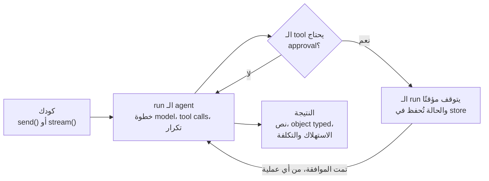

معظم كود الـ agents يبدأ كحلقة تلفّ حول استدعاء model. بعدها يأتي الإنتاج ويطلب أكثر: لازم إنسان يوافق على استرداد المبلغ قبل إرساله. العملية تُعاد تشغيلها والـ run في منتصفه. المحادثة لازم تكمل غدًا من سيرفر آخر. وشخص ما يريد اختبار يفشل لما الـ agent يوقف عن استدعاء الـ tool الصحيح.

`@lousho/build-ai-agent` هي هذه الحلقة وهذه الإجابات مدمجة فيها. مكتبة، لا web framework ولا hosted runtime: حلقة استدعاء tools من نوع typed، مع approvals (موافقات) و sessions (جلسات) و streaming و sub-agents و skills و MCP و CLI. ونفس الـ agent يشتغل في سكربت، أو سيرفر Node، أو حاوية Docker، أو Cloudflare Worker (الـ Worker يدعم [جزءًا](/ar/cloudflare-workers#ما-يعمل-وما-لا-يعمل) فقط من الـ providers والـ tools).



```ts
import { createAgent } from '@lousho/build-ai-agent';

const agent = createAgent({ model: 'openai/gpt-4.1-mini', instructions: 'You are a helpful assistant.' });
const { text } = await agent.send('Hello!');
console.log(text);
```

## ما يميّزها

<CardGroup cols={2}>
  <Card title="تسجيل وإعادة تشغيل واكتشاف الانحراف" icon="flask-conical" href="/ar/evals">
    `lousho eval --record` يحفظ run حقيقي لكل حالة مع الـ provider في cassette، و`--replay` يشغّلها في CI بدون شبكة ولا مفتاح، و`--drift` يعيد التسجيل ويوضّح كيف تغيّر مسار استدعاءات الـ tools. و`defineEval()` يتحقق من الـ tools التي استُدعيت، وبأي ترتيب، وبأي معاملات.
  </Card>
  <Card title="Approvals متينة على stores عندك" icon="database" href="/ar/durable-execution">
    الـ sessions والـ checkpoints وتوقفات الـ approval محفوظة في الذاكرة، أو ملفات، أو ملف SQLite واحد، أو Cloudflare KV. والـ run المتوقف مؤقتًا أو المنقطع يستأنف من طلب آخر أو عملية أخرى، حتى على Worker.
  </Card>
  <Card title="agent واحد وواجهات كثيرة" icon="activity" href="/ar/deployment">
    `lousho build` ينشر الـ agent على سيرفر Node أو Docker أو Worker؛ و`lousho acp` يقدّمه للمحررات، و`serveMcp` لعملاء MCP. وكل run يصدر spans وفق OpenTelemetry GenAI مع استهلاك الـ tokens والتكلفة بالدولار الأمريكي.
  </Card>
  <Card title="مستضاف عندك، مع كل إصدارات AI SDK" icon="box" href="/ar/installation">
    حزمة واحدة، بدون حساب على منصة ولا control plane مستضاف. الـ peer `ai` يقبل v4 و v6 و v7، و`fromAiSdk()` / `fromAiSdkTools()` يعيدان استخدام الـ models والـ tools اللي عندك من AI SDK.
  </Card>
</CardGroup>

## المكوّنات

كل مكوّن هو دالة واحدة أو خيار واحد على `createAgent()`. استخدم ما تحتاجه؛ لا مكوّن يتطلب غيره.

| المكوّن | ما تكتبه | ما تحصل عليه |
| ----- | -------------- | ------------ |
| [Tools](/ar/tools) | `defineTool()` مع `input` من zod | معاملات typed مع validation، والاستدعاءات تشتغل بالتوازي |
| [Approvals](/ar/approvals) | `needsApproval`، أو قواعد `permissions` | run يتوقف مؤقتًا بانتظار إنسان، ثم يكمل عبر `agent.approvals.resolve()` |
| [Sessions](/ar/sessions) | `agent.session({ id })` | محادثة متعددة الدورات تُحفظ في الذاكرة أو الملفات أو SQLite |
| [الذاكرة](/ar/memory) | خانات `defineMemory()` | حقائق تدخل الـ prompt عبر الـ sessions، لكل مستخدم أو على مستوى عام |
| [المخرجات المنظمة](/ar/structured-output) | `output: zodSchema` | `result.object` typed مع validation، وخطوة إصلاح واحدة |
| [Streaming](/ar/streaming) | `agent.stream()` | أحداث JSON typed وذات إصدارات، جاهزة لـ SSE |
| [Sub-agents](/ar/sub-agents) | `subagents: { researcher, writer }` | أداة `task` واحدة للـ agent الرئيسي؛ والـ sub-agents تشتغل بالتوازي، محليًا أو عن بُعد |
| [Skills](/ar/skills) | `loadSkills()` | تعليمات ما يحمّلها الـ agent إلا لما تحتاجها المهمة |
| [Providers](/ar/providers) | سلسلة بصيغة `provider/model` | OpenAI أو Anthropic أو Google أو OpenRouter أو Ollama أو mock، مع retry و fallback؛ وأي model من AI SDK عبر `fromAiSdk()` |

## أين يعيش الـ agent

الـ agent هو نفس الكائن في كل مكان. اللي يتغير هو الواجهة اللي تقف أمامه.

<CardGroup cols={2}>
  <Card title="في تطبيق ويب" icon="browser" href="/ar/react">
    `useLoushoAgent()` لـ React و Vue، وstore لـ Svelte، و`useChat` من Vercel AI SDK، أو `createRouteHandler(agent)` في أي إطار عمل مبني على Fetch API.
  </Card>
  <Card title="في المحادثات وعلى جدول" icon="message-square" href="/ar/channels">
    قنوات Slack و Discord و webhooks و HTTP العادي تربط الرسائل بالـ sessions وترجّع الـ approvals للقناة. وجدولات cron تبدأ runs من تلقاء نفسها.
  </Card>
  <Card title="في محرّر" icon="code" href="/ar/acp">
    `lousho acp` يقدّم الـ agent عندك إلى Zed وغيره من محررات Agent Client Protocol، مع الـ tool calls وطلبات الصلاحيات.
  </Card>
  <Card title="كخدمة منشورة" icon="rocket" href="/ar/deployment">
    `lousho build` ينتج سيرفر Node أو صورة Docker أو Cloudflare Worker من spec واحد.
  </Card>
</CardGroup>

## مقارنة بمكتبات أخرى

`@lousho/build-ai-agent` يقع في طبقة واحدة فوق استدعاء الـ model: مثل agents الخاصة بـ AI SDK 7، و eve، و Mastra، و LangGraph، و OpenAI Agents SDK، و Claude Agent SDK، يشغّل agent loop كامل. وهو مبني فوق Vercel AI SDK وليس بديلًا عنه: الـ providers المدمجة تستخدم `ai` و`@ai-sdk/*`، و`fromAiSdk()` يغلّف أي model آخر من AI SDK.

الـ approvals المتينة والـ evals والـ agent directories و harnesses الـ coding agents لم تعد ميزات حصرية: AI SDK 7 و eve و Mastra تقدّم نسخها الخاصة. ما يميّز Lousho حتى الآن هو التسجيل وإعادة التشغيل مع اكتشاف انحراف المسار، والـ approvals المتينة على Cloudflare Workers KV، وتقديم نفس الـ agent عبر ACP و MCP، والعمل كحزمة واحدة مستضافة عندك. وهو أضعف حيث ما زال صغيرًا: في مرحلة alpha، بدون store لـ Postgres، وبـ providers مدمجة أقل، وبدون لوحة تحكم مستضافة. وفي [المقارنة](/ar/comparison) جدول لكل مشروع، مؤرّخ، مع ما يتفوّق فيه كل منافس.

متى يكون خيار آخر أنسب: إذا كان كل اللي تحتاجه هو بثّ نص الـ model في route من Next.js، فـ AI SDK وحده أخفّ وأقل سطحًا. وإذا تنشر على Vercel وتريد الـ runtime الخاص بها، فـ eve يناسبها مباشرة. وإذا تريد harness الخاص بـ Claude Code كما هو، فـ Claude Agent SDK يعطيك ذلك بالضبط. وإذا فريقك يعمل بـ Python أو يشغّل LangGraph Platform أصلًا، فالبقاء هناك يوفّر عليك stack ثاني. قادم من AI SDK؟ اقرأ [الانتقال من AI SDK](/ar/migrating-from-ai-sdk).

## الخطوات التالية

- [البدء السريع](/ar/quickstart): جهّز مشروعًا بقالب جاهز، أو شغّل الـ agent المكوّن من خمسة أسطر. المقتطفات تشتغل دون اتصال بفضل الـ mock provider المدمج.
- [التثبيت](/ar/installation): المتطلبات، وpeer dependencies، وأي حزمة provider تلائم أي إصدار رئيسي من `ai`.
- [Tools](/ar/tools): عرّف أول tool لك وانظر كيف يتم الـ validation للمعاملات.
- [Approvals](/ar/approvals): أوقف run مؤقتًا بانتظار قرار إنسان ثم استأنفه.
- [الاختبار](/ar/testing): اكتب اختبار deterministic للـ agent بدون مفتاح API.
- [الانتقال من AI SDK](/ar/migrating-from-ai-sdk): انقل حلقة `ToolLoopAgent` أو `generateText`، مع الـ models والـ tools الخاصة بها.
- [Lousho مع coding agents](/ar/coding-agents): وجّه Claude Code أو Cursor أو أي coding agent آخر إلى توثيق يستطيع قراءته.
