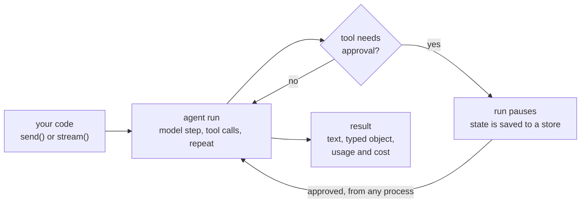

Most agent code starts as a loop around a model call, and then production asks for more: a human has to approve the refund before it is sent, the process restarts halfway through a run, the conversation has to continue tomorrow from another server, and somebody wants a test that fails when the agent stops calling the right tool.

`@lousho/build-ai-agent` is that loop with those answers built in. It is a library, with no web framework and no hosted runtime: a typed tool-calling loop with approvals, sessions, streaming, sub-agents, skills, MCP and a CLI. The same agent runs in a script, a Node server, a Docker container or a Cloudflare Worker (a Worker supports a [subset](/cloudflare-workers#what-works-and-what-does-not) of the providers and tools).



```ts
import { createAgent } from '@lousho/build-ai-agent';

const agent = createAgent({ model: 'openai/gpt-4.1-mini', instructions: 'You are a helpful assistant.' });
const { text } = await agent.send('Hello!');
console.log(text);
```

## What sets it apart

<CardGroup cols={2}>
  <Card title="Record, replay and catch drift" icon="alien-8bit" href="/evals">
    `lousho eval --record` saves each case's real provider run as a cassette, `--replay` runs it in CI with no network or key, and `--drift` re-records and reports how the tool-call trajectory changed. `defineEval()` asserts on which tools were called, in what order, with which arguments.
  </Card>
  <Card title="Durable approvals on your own stores" icon="database" href="/durable-execution">
    Sessions, checkpoints and approval pauses live in memory, files, one SQLite file or Cloudflare KV. A paused or interrupted run resumes from another request or another process, on a Worker too.
  </Card>
  <Card title="One agent, many surfaces" icon="robot" href="/deployment">
    `lousho build` ships the agent to a Node server, Docker or a Worker; `lousho acp` serves it to editors and `serveMcp` to MCP clients. Runs emit OpenTelemetry GenAI spans with token usage and USD cost.
  </Card>
  <Card title="Self-hosted, across AI SDK majors" icon="computer" href="/installation">
    One package, no platform account or hosted control plane. The `ai` peer accepts v4, v6 and v7, and `fromAiSdk()` / `fromAiSdkTools()` reuse your existing AI SDK models and tools.
  </Card>
</CardGroup>

## The building blocks

Each block is one function or one option on `createAgent()`. Use the ones you need; none of them requires the others.

| Block | What you write | What you get |
| ----- | -------------- | ------------ |
| [Tools](/tools) | `defineTool()` with a zod `input` | Arguments typed and validated, calls run in parallel |
| [Approvals](/approvals) | `needsApproval`, or `permissions` rules | A run that pauses for a human, then continues with `agent.approvals.resolve()` |
| [Sessions](/sessions) | `agent.session({ id })` | A multi-turn conversation kept in memory, files or SQLite |
| [Memory](/memory) | `defineMemory()` slots | Facts recalled into the prompt across sessions, per user or globally |
| [Structured output](/structured-output) | `output: zodSchema` | A typed, validated `result.object`, with one repair step |
| [Streaming](/streaming) | `agent.stream()` | Typed, versioned JSON events, ready for SSE |
| [Sub-agents](/sub-agents) | `subagents: { researcher, writer }` | One `task` tool for the lead; sub-agents run in parallel, locally or remotely |
| [Skills](/skills) | `loadSkills()` | Instructions the agent loads only when a task needs them |
| [Providers](/providers) | a `provider/model` string | OpenAI, Anthropic, Google, OpenRouter, Ollama or a mock, with retry and fallback; any AI SDK model via `fromAiSdk()` |

## Where an agent can live

The agent is the same object everywhere. What changes is the surface in front of it.

<CardGroup cols={2}>
  <Card title="In a web app" icon="browser" href="/react">
    `useLoushoAgent()` for React and Vue, a store for Svelte, the Vercel AI SDK's `useChat`, or `createRouteHandler(agent)` in any Fetch-API framework.
  </Card>
  <Card title="In chat and on a schedule" icon="message" href="/channels">
    Slack, Discord, webhooks and plain HTTP channels map messages to sessions and send approvals back. Cron schedules start runs on their own.
  </Card>
  <Card title="In an editor" icon="code" href="/acp">
    `lousho acp` serves your agent to Zed and other Agent Client Protocol editors, with tool calls and permission prompts.
  </Card>
  <Card title="As a deployed service" icon="rocket" href="/deployment">
    `lousho build` produces a Node server, a Docker image or a Cloudflare Worker from one spec.
  </Card>
</CardGroup>

## Compared to other libraries

`@lousho/build-ai-agent` sits one layer above a model call: like the AI SDK 7 agents, eve, Mastra, LangGraph, the OpenAI Agents SDK or the Claude Agent SDK, it runs a full agent loop. It builds on the Vercel AI SDK rather than replacing it: the built-in providers use `ai` and `@ai-sdk/*`, and `fromAiSdk()` wraps any other AI SDK model.

Durable approvals, evals, agent directories and coding-agent harnesses are no longer unique: AI SDK 7, eve and Mastra ship their own. What Lousho still does differently is record/replay with trajectory drift, durable approvals on Cloudflare Workers KV, serving the same agent over ACP and MCP, and running as one self-hosted package. It is weaker where it is young: it is in alpha, has no Postgres store, fewer native providers and no hosted dashboard. The [comparison](/comparison) has the per-project table, dated, with where each rival is ahead.

When something else fits better: if you only need to stream model text in a Next.js route, the AI SDK alone is less surface; if you deploy on Vercel and want its runtime, eve fits it natively; if you want Claude Code's own harness, the Claude Agent SDK gives you exactly that; if your team is on Python or already runs LangGraph Platform, staying there avoids a second stack. Coming from the AI SDK? See [Migrating from the AI SDK](/migrating-from-ai-sdk).

## Next steps

- [Quick start](/quickstart): scaffold a project, or run the five-line agent. The snippets run offline with the built-in mock provider.
- [Installation](/installation): requirements, peer dependencies, and which provider package pairs with which `ai` major.
- [Tools](/tools): define your first tool and see how arguments are validated.
- [Approvals](/approvals): pause a run for a human decision and resume it.
- [Testing](/testing): write a deterministic test for an agent without an API key.
- [Migrating from the AI SDK](/migrating-from-ai-sdk): move a `ToolLoopAgent` or `generateText` loop, its models and its tools.
- [Lousho with coding agents](/coding-agents): point Claude Code, Cursor or another coding agent at docs it can read.
