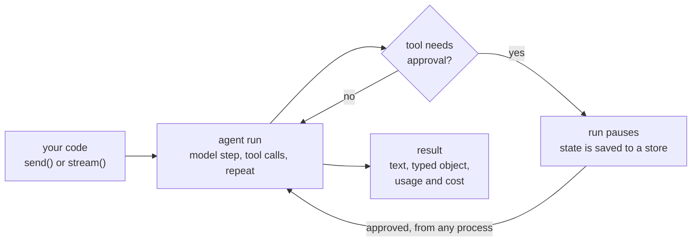

Most agent code starts as a loop around a model call, and then production asks for more: a human has to approve the refund before it is sent, the process restarts halfway through a run, the conversation has to continue tomorrow from another server, and somebody wants a test that fails when the agent stops calling the right tool.

`@lousho/build-ai-agent` is that loop with those answers built in. It is a library, with no web framework and no hosted runtime: a typed tool-calling loop with approvals, sessions, streaming, sub-agents, skills, MCP and a CLI. The same agent runs in a script, a Node server, a Docker container or a Cloudflare Worker (a Worker supports a [subset](/cloudflare-workers#what-works-and-what-does-not) of the providers and tools).



```ts
import { createAgent } from '@lousho/build-ai-agent';

const agent = createAgent({ model: 'openai/gpt-4o-mini', instructions: 'You are a helpful assistant.' });
const { text } = await agent.send('Hello!');
console.log(text);
```

## What sets it apart

<CardGroup cols={3}>
  <Card title="Durable on any host" icon="database" href="/durable-execution">
    Sessions, checkpoints and approval pauses live in pluggable stores: memory, files, one SQLite file, or Cloudflare KV. A paused or interrupted run resumes from another request or another process.
  </Card>
  <Card title="Tested like code" icon="flask-conical" href="/testing">
    `mockModel` scripts the model, `recordReplay` cassettes replay real runs offline, and `defineEval()` asserts on which tools were called, in what order, with which arguments.
  </Card>
  <Card title="Node and Workers, traced" icon="activity" href="/deployment">
    `lousho build` ships one agent spec to a Node server, Docker or a Worker. Runs emit OpenTelemetry GenAI spans, and every result reports token usage, plus USD cost for models with a known price.
  </Card>
</CardGroup>

## The building blocks

Each block is one function or one option on `createAgent()`. Use the ones you need; none of them requires the others.

| Block | What you write | What you get |
| ----- | -------------- | ------------ |
| [Tools](/tools) | `defineTool()` with a zod `input` | Arguments typed and validated, calls run in parallel |
| [Approvals](/approvals) | `needsApproval`, or `permissions` rules | A run that pauses for a human, then continues with `agent.approvals.resolve()` |
| [Sessions](/sessions) | `agent.session({ id })` | A multi-turn conversation kept in memory, files or SQLite |
| [Memory](/memory) | `defineMemory()` slots | Facts recalled into the prompt across sessions, per user or globally |
| [Structured output](/structured-output) | `output: zodSchema` | A typed, validated `result.object`, with one repair step |
| [Streaming](/streaming) | `agent.stream()` | Typed, versioned JSON events, ready for SSE |
| [Sub-agents](/sub-agents) | `subagents: { researcher, writer }` | One `task` tool for the lead; sub-agents run in parallel, locally or remotely |
| [Skills](/skills) | `loadSkills()` | Instructions the agent loads only when a task needs them |
| [Providers](/providers) | a `provider/model` string | OpenAI, Anthropic, OpenRouter, Ollama or a mock, with retry and fallback |

## Where an agent can live

The agent is the same object everywhere. What changes is the surface in front of it.

<CardGroup cols={2}>
  <Card title="In a web app" icon="browser" href="/react">
    `useLoushoAgent()` for React and Vue, a store for Svelte, the Vercel AI SDK's `useChat`, or `createRouteHandler(agent)` in any Fetch-API framework.
  </Card>
  <Card title="In chat and on a schedule" icon="message-square" href="/channels">
    Slack, Discord, webhooks and plain HTTP channels map messages to sessions and send approvals back. Cron schedules start runs on their own.
  </Card>
  <Card title="In an editor" icon="code" href="/acp">
    `lousho acp` serves your agent to Zed and other Agent Client Protocol editors, with tool calls and permission prompts.
  </Card>
  <Card title="As a deployed service" icon="rocket" href="/deployment">
    `lousho build` produces a Node server, a Docker image or a Cloudflare Worker from one spec.
  </Card>
</CardGroup>

## Compared to other libraries

`@lousho/build-ai-agent` sits one layer above a model call: like LangGraph, Mastra, the OpenAI Agents SDK or the Claude Agent SDK it runs a full agent loop, as a library with no required platform, web framework or hosted runtime. It builds on the Vercel AI SDK rather than replacing it: the built-in OpenAI, Anthropic and OpenRouter providers use `ai` and `@ai-sdk/*`, and `fromAiSdk()` wraps any other AI SDK model. What it adds on top is the production layer: checkpoints, durable approvals, sessions, channels and deploy targets.

The table is a summary as of late 2026. These libraries move fast, so check each project's own documentation before you rely on a cell. "Partial" means the capability exists but is narrower, or you assemble part of it yourself.

| Capability | `@lousho/build-ai-agent` | Vercel AI SDK (v6) | LangChain / LangGraph | Mastra | OpenAI Agents SDK | Claude Agent SDK |
| ---------- | ---------------------- | ------------------ | --------------------- | ------ | ----------------- | ---------------- |
| Agent loop | Yes — `createAgent()` | Yes — `ToolLoopAgent`, or `generateText` / `streamText` with tools | Yes — graphs, or prebuilt agents | Yes — `Agent` | Yes — `Agent` and `run()` | Yes — `query()` runs the Claude Code harness |
| Model providers | OpenAI, Anthropic, OpenRouter, Ollama and a mock built in; any AI SDK model via `fromAiSdk()` | Yes — the widest provider set | Yes — through LangChain integrations | Yes — through the AI SDK | Partial — OpenAI first; others through adapters | Partial — Claude models only (Anthropic API, Bedrock, Vertex) |
| Typed event stream | Yes — `agent.stream()` emits versioned, sequenced JSON events for runs, steps, tokens and tool calls, SSE-ready | Yes — typed stream parts and UI message streams | Yes — node/graph events via `streamEvents` | Yes — agent and workflow streams | Yes — streamed run events | Yes — typed messages from `query()` |
| Durable execution, checkpoints | Yes — checkpoints in pluggable stores (memory, files, SQLite, Cloudflare KV); a crashed or paused run resumes in another process. No Postgres or Redis store yet | Partial — you persist the messages; durable workflows are a separate project | Yes — checkpointers save thread state | Yes — workflow suspend/resume snapshots | Partial — an interrupted run's `RunState` serializes and resumes in another process; storing it is up to you | Partial — sessions resume or fork from local transcript files |
| Approvals (human-in-the-loop) | Yes — `needsApproval` pauses the run; `agent.approvals.resolve()` continues it from any process | Yes — tool `needsApproval`; you keep the pending state between requests | Yes — `interrupt()` and human nodes | Yes — human steps in workflows | Yes — function tools take `needsApproval`; the run returns interruptions you approve or reject | Yes — `canUseTool` callback and permission modes, decided in-process |
| Channels | Yes — `mountChannels()` serves Slack, Discord, Teams, Telegram, GitHub, webhook and HTTP surfaces, with approvals back to the channel | No | No — community adapters only | Partial — some deploy/chat integrations | No | No |
| Deploy targets | `lousho build` emits a Node server, Docker image or Cloudflare Worker from one spec (a Worker supports a subset of providers and tools) | BYO — runs wherever your app runs | BYO, or LangGraph Platform (hosted) | `mastra build` targets Node, Vercel, Netlify, Workers | BYO — the loop runs in your process | BYO — runs where Claude Code can run |
| Sessions | Yes — `agent.session({ id })` over memory, file or SQLite stores | No — you keep the message array | Yes — threads and chat-history helpers | Yes — threads and memory | Yes — session objects keep conversation history | Yes — resume a session by id |
| MCP | Client (`mcpServers`) and server (`serveMcp`) | Client (`createMCPClient`) | Client via adapters | Yes — MCP client and server | Yes — MCP servers as tool sources | Client, plus in-process SDK servers |
| Guardrails | Partial — input/output/tool guardrails, with heuristic PII, secret and prompt-injection checks (a first filter, not a security boundary) and a model-based moderation check | Partial — compose with middleware | Partial — community guardrails and LangSmith evaluators | Yes — input/output processors | Yes — input/output guardrails | Partial — through hooks and permission rules |

When something else fits better: if you only need to stream model text in a Next.js route, the AI SDK alone is less surface; if you want Claude Code's own harness and tools, the Claude Agent SDK gives you exactly that; if your team is on Python or already runs LangGraph Platform, staying in that ecosystem avoids a second stack. `@lousho/build-ai-agent` is aimed at TypeScript teams that want a durable, approvable agent loop inside their own process, on more than one model provider, without adopting a platform. It is in alpha: APIs can still change.

## Next steps

- [Quick start](/quickstart): scaffold a project, or run the five-line agent. The snippets run offline with the built-in mock provider.
- [Installation](/installation): requirements, peer dependencies, and which provider package pairs with which `ai` major.
- [Tools](/tools): define your first tool and see how arguments are validated.
- [Approvals](/approvals): pause a run for a human decision and resume it.
- [Testing](/testing): write a deterministic test for an agent without an API key.
- [Lousho with coding agents](/coding-agents): point Claude Code, Cursor or another coding agent at docs it can read.
